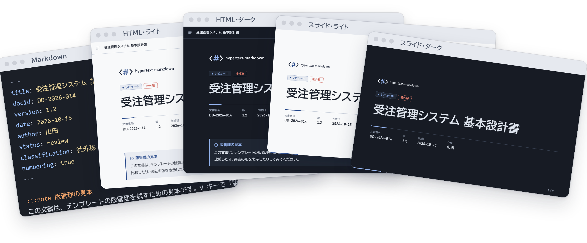
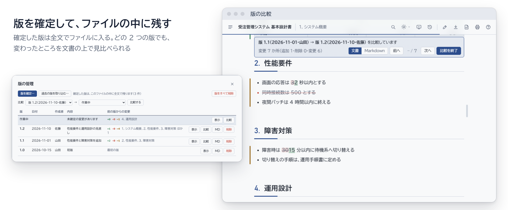
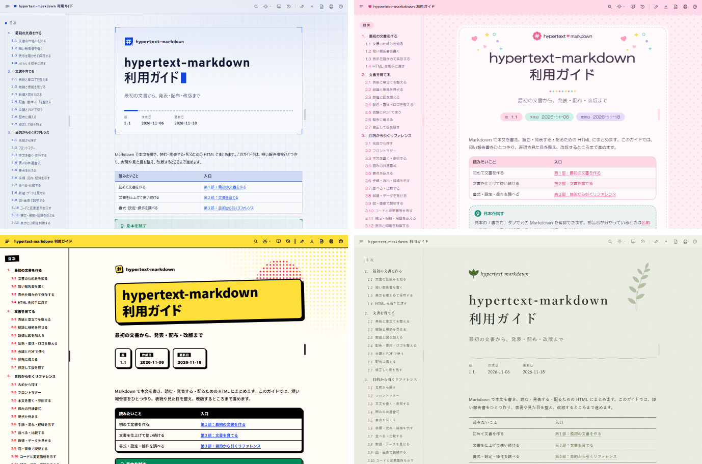
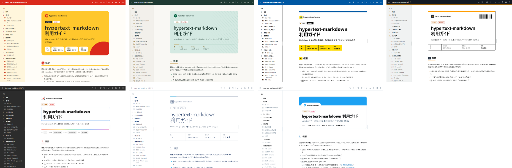

<h1 align="center">
  <picture>
    <source media="(prefers-color-scheme: dark)" srcset="docs/images/readme-title-dark.png">
    
  </picture>
</h1>

<p align="center">
  <a href="https://github.com/tsunyan/hypertext-markdown/actions/workflows/ci.yml"></a>
  <a href="https://github.com/tsunyan/hypertext-markdown/actions/workflows/codeql.yml"></a>
  <a href="LICENSE"></a>
  <a href="https://tsunyan.github.io/hypertext-markdown/template-guide.min.html"></a>
  <a href="#ai-エージェントで使う"></a>
</p>

Markdown で書き、HTML ひとつで渡す。**hypertext-markdown** は、目次・スライド・版の管理を備えた文書テンプレート。調査メモや設計書を、読むときも、説明するときも、同じ文書のまま使える。

**[利用ガイドを開く](https://tsunyan.github.io/hypertext-markdown/template-guide.min.html)** · **[空のテンプレートで始める](https://tsunyan.github.io/hypertext-markdown/skills/hypertext-markdown/assets/template.html)** · **[版管理の見本を見る](https://tsunyan.github.io/hypertext-markdown/samples/sample-versioned.src.html)**

<p align="center">
  <picture>
    <source media="(prefers-color-scheme: dark)" srcset="docs/images/readme-views-dark.png">
    
  </picture>
</p>

- **ひとつの本文から、読み物・スライド・PDFへ。** 見出しから目次とスライドを作り、用途に合わせて表示を切り替える。
- **渡すのは HTML ファイルひとつ。** Markdown・表示用の CSS・JavaScript を内包し、画像も埋め込める。読むためのアプリのインストールやサーバーの用意は不要。
- **改版の経緯も文書と一緒に。** 確定した版をファイル内に残し、任意の 2 つの版を見比べられる。

[始め方](#始め方) · [読む伝える改版する](#読む伝える改版する) · [文書を組み立てる](#文書を組み立てる) · [デザインを選ぶ](#デザインを選ぶ) · [開発](#開発)

## 始め方

### ブラウザで作る

1. [空のテンプレート](https://tsunyan.github.io/hypertext-markdown/skills/hypertext-markdown/assets/template.html)を開く。
2. 手元の `.md` ファイルを画面へドロップするか、<kbd>E</kbd> で編集欄を開いて Markdown を書く。画像は編集欄への貼り付け・ドロップで埋め込める。
3. <kbd>Ctrl</kbd>+<kbd>S</kbd> で HTML をダウンロードする。そのファイルを相手に渡す。

修正するときは、保存した HTML をブラウザで開き、同じ手順で編集・保存する。元のファイルを直接上書きする操作ではないので、ダウンロードした最新版を使う。

書き方を試すなら、[利用ガイド](https://tsunyan.github.io/hypertext-markdown/template-guide.min.html)の各見本で「表示」と「書き方」を切り替えられる。ガイドには説明用の版 1.0・1.1 が入っているため、新しい文書には空のテンプレートから始めるとよい。

### AI エージェントで使う

文書の作成・修正用の [Agent Skill](skills/hypertext-markdown/) を用意している。Node.js がある環境でインストールする。

```bash
npx skills add tsunyan/hypertext-markdown
```

エージェントには、使うテンプレートと作りたい文書を伝える。

> hypertext-markdown で、この調査結果を報告書にして。結論、比較、推奨案の順にまとめ、会議でスライドとしても使えるようにして。

スキルには、[作成・修正の手順](skills/hypertext-markdown/SKILL.md)、[書式と雛形](skills/hypertext-markdown/references/authoring.md)、HTML を作るスクリプトが含まれる。

AI は手順と必要な書式を参照して Markdown を書く。テンプレートの HTML はスクリプトが読み込むため、AI のコンテキストに入れる必要はない。既存の HTML の修正も、Markdown を取り出して行える。

### コマンドで作る

このリポジトリを取得した環境では、Node.js 18 以上で `.md` から HTML を作れる。ビルドスクリプトに追加パッケージは不要。

```bash
node skills/hypertext-markdown/scripts/build.mjs report.md -o report.html
```

手元の画像も自動で埋め込まれる。デザインを指定する場合は `--template samples/template-guide-cyber.src.html` のようにテンプレートを渡す。

ロゴと favicon もファイルで指定できる。画像のパスは実行フォルダ基準で、HTML に埋め込まれる。

```bash
node skills/hypertext-markdown/scripts/build.mjs report.md --logo ./logo.svg --logo-dark ./logo-dark.svg --favicon ./favicon.png --favicon ./favicon.svg
```

`--logo` だけなら明暗共通のロゴになる。`--favicon` は SVG・PNG・ICO を複数指定でき、既存の favicon 一式を置き換える。文書のフロントマターに `logo` がある場合は、そちらが優先する。

既存の文書を直すときは、Markdown を取り出して編集し、元の HTML をテンプレートにして戻す。`--keep-versions` で確定済みの版を引き継ぐ。

```bash
node skills/hypertext-markdown/scripts/build.mjs --extract report.html -o report.md
# report.md を編集する
node skills/hypertext-markdown/scripts/build.mjs report.md --template report.html --keep-versions -o report.html
```

### 配布する前に

ブラウザで HTML を開き、本文と図を確認してから <kbd>Ctrl</kbd>+<kbd>S</kbd> で保存すると、**描画済みの本文と図も含む HTML** になる。このファイルは JavaScript が無効でも本文を読める。コマンドで生成した直後の HTML には描画済みの本文がないため、この保存を行ってから渡す。

Markdown の変換や通常の表示はファイル内で完結する。Mermaid の図を描くときは CDN からライブラリを読み込むが、描画後に保存した図はオフラインでも表示できる。外部 URL の画像は自動では埋め込まれないため、ファイルひとつで配る場合は画像も埋め込む。

## 読む・伝える・改版する

### 読む

H2・H3 から目次を作り、読んでいる章と節を表示する。文書内の検索は、閉じた折りたたみや選んでいないタブの中も探せる。ライト・ダーク・OS に合わせる表示を切り替えられ、本文の幅も右端の取っ手で調整できる。

| 操作 | キー |
|---|---|
| 文書内を検索 | <kbd>/</kbd> |
| テーマを切り替え | <kbd>T</kbd> |
| スライドを表示 | <kbd>S</kbd> |
| Markdown を編集 | <kbd>E</kbd> |
| Markdown をダウンロード | <kbd>D</kbd> |
| HTML として保存 | <kbd>Ctrl</kbd>+<kbd>S</kbd> |
| 印刷・PDF | <kbd>Ctrl</kbd>+<kbd>P</kbd> |
| 版を管理 | <kbd>V</kbd> |
| ショートカットの一覧 | <kbd>?</kbd> |

### スライド・PDFで伝える

H2（設定によっては H3）ごとにスライドを作る。1 枚に収まらない内容は、文字を 80% まで縮め、それでも収まらなければ段落・表の行・コードの行などの切れ目で分割する。手動で区切るときは `<!-- slide -->`、印刷にも区切りを入れるときは `<!-- pagebreak -->` を使う。

印刷は表示モードに合わせて変わる。読み物では表紙・目次・本文を並べ、スライドでは 16:9 の 1 枚を 1 ページにする。`doc-only`・`slide-only` の囲みで、詳しい説明と発表用の要点を出し分けることもできる。

### 版を残して比べる

<kbd>V</kbd> の「版を確定…」で版番号・日付・作成者・内容を入力すると、その時点の Markdown をファイル内に残して HTML を保存する。本文に `:::history` の囲みを置けば、改版履歴の表になる。

<p align="center">
  <picture>
    <source media="(prefers-color-scheme: dark)" srcset="docs/images/readme-versions-dark.png">
    
  </picture>
</p>

任意の 2 つの版や作業中の文書を、文書の表示・Markdown の両方で比較できる。変更した段落には改訂線、変わった語には取り消し線と下線が付き、<kbd>N</kbd> / <kbd>Shift</kbd>+<kbd>N</kbd> で変更箇所へ移動する。過去の版や比較結果もスライド・印刷に使える。

[版管理の見本](https://tsunyan.github.io/hypertext-markdown/samples/sample-versioned.src.html)には、基本設計書の版 1.0〜1.2 と未確定の変更が入っている。開いて <kbd>V</kbd> を押すと試せる。

版は差分ではなく全文で残すため、版や埋め込み画像が増えるほどファイルも大きくなる。画像は縮小してから入れると扱いやすい。

## 文書を組み立てる

見出し・表・リストなど、普通の Markdown を基本に書く。説明に合わせて見せ方を変えたいところだけ、`:::名前` から `:::` までの囲みを使う。

```markdown
# 導入計画

## 進め方

:::steps
1. **現状を調べる**
2. **小さく試す**
3. **全体に展開する**
:::
```

### 表現のための部品

| 用途 | 部品・書式 |
|---|---|
| 流れを示す | `steps`（手順）、`flow`（工程）、`timeline`（時系列） |
| 並べる・比べる | `cards`、`columns`、`compare`、`pros-cons`、`tabs` |
| 要点を強調する | `summary`（要旨）、`lead`、`metrics`（数値）、`progress` |
| 補足する | `note`、`tip`、`important`、`warning`、`caution`、`details`、`qa`、`quote` |
| 構造を示す | `figure`・`table`（図表番号）、`spec`（項目と値）、`tree` |
| データを見せる | `chart`（表からグラフを作る） |
| 用語を説明する | `glossary`、`*[略語]: 意味` |
| 履歴・見本を載せる | `history`（改版履歴）、`example`（表示と書き方） |
| 表示を出し分ける | `doc-only`、`slide-only` |
| 文中に添える | `:ok[完了]` などのラベル、`:menu[設定 > ネットワーク]`、`[](#ID)` による章・図表の参照 |
| 独自の囲みを作る | 任意の名前を `c-名前` クラスにし、テンプレートの CSS で装飾 |

Zenn 形式の `:::message`・`:::details タイトル` にも対応する。構文と最小の例は[書式リファレンス](skills/hypertext-markdown/references/authoring.md)、描画結果は[利用ガイド](https://tsunyan.github.io/hypertext-markdown/template-guide.min.html)で確認できる。

### コード・表・グラフ

コードは言語に合わせて色分けする。`diff`・`patch` のコードブロックは、ファイルごとの枠と行番号を持つ差分になり、統合表示・左右表示を切り替えられる。

Markdown の表と CSV・TSV のコードブロックは、並べ替え・絞り込み・Excel 向けのコピーに対応する。`chart` で表を囲めば、縦棒・横棒・積み上げ・折れ線・面・構成比のグラフになり、グラフと元データをタブで切り替えられる。

### 色・書体・画像

Markdown の先頭にフロントマターを書くと、文書名や見た目を指定できる。

```yaml
---
title: 導入計画
palette: teal
font: gothic
---
```

`palette` は 8 種類の配色、`accent` は強調色、`font`・`mono` は本文・コードの書体、`logo` は表紙とスライドのロゴを指定する。書体は閲覧する PC にあるものを使う。

画像は普通の Markdown で書ける。編集欄への貼り付けやビルドスクリプトで埋め込むと、画像ファイルを別に渡す必要がない。ライト・ダークで画像を出し分ける書式にも対応する。

HTML や SVG を本文に直接書くこともできる。表示用のタグ・属性・CSS に対応し、スクリプト・iframe・フォームなどは取り除く。

## デザインを選ぶ

同じ機能と利用ガイドに、CSS・ロゴ・favicon を重ねた見本。どれもライト・ダークに対応する。好みの見本を開いて `.md` をドロップし、版を消して新しい文書として使うか、ビルド時の `--template` に指定する。

<p align="center">
  <picture>
    <source media="(prefers-color-scheme: dark)" srcset="samples/design/overview-dark.png">
    
  </picture>
</p>

| デザイン | 特徴 |
|---|---|
| [サイバー](https://tsunyan.github.io/hypertext-markdown/samples/template-guide-cyber.src.html) | 計器盤と設計図を思わせる方眼・目盛り・等幅の数字 |
| [キュート](https://tsunyan.github.io/hypertext-markdown/samples/template-guide-cute.src.html) | 水玉の台紙、丸い字、縫い目の点線、テープ風のカード |
| [ポップ](https://tsunyan.github.io/hypertext-markdown/samples/template-guide-pop.src.html) | 太い線とずらした影、黄色の題名、網点 |
| [ナチュラル](https://tsunyan.github.io/hypertext-markdown/samples/template-guide-natural.src.html) | 明朝の見出し、細い線、葉の形の角、苔と樹皮の色 |

配色を中心に選ぶための見本もある。

<p align="center">
  <picture>
    <source media="(prefers-color-scheme: dark)" srcset="samples/design/overview-cc-dark.png">
    
  </picture>
</p>

| 配色 | 見本 |
|---|---|
| 赤と黄 | [cc-1](https://tsunyan.github.io/hypertext-markdown/samples/template-guide-cc-1.src.html) |
| 深緑と生成り | [cc-2](https://tsunyan.github.io/hypertext-markdown/samples/template-guide-cc-2.src.html) |
| 青と黄 | [cc-3](https://tsunyan.github.io/hypertext-markdown/samples/template-guide-cc-3.src.html) |
| 濃紺と橙 | [cc-4](https://tsunyan.github.io/hypertext-markdown/samples/template-guide-cc-4.src.html) |
| 赤と黒 | [cc-5](https://tsunyan.github.io/hypertext-markdown/samples/template-guide-cc-5.src.html) |
| 紺と水色 | [cc-6](https://tsunyan.github.io/hypertext-markdown/samples/template-guide-cc-6.src.html) |
| 空色と白 | [cc-7](https://tsunyan.github.io/hypertext-markdown/samples/template-guide-cc-7.src.html) |

## 開発

正本は [src/](src/) の HTML の外枠・CSS・JavaScript・Markdown。 favicon とロゴも画像ファイルで管理する。組み立てた `template-guide.src.html` と圧縮版・見本・スキルの空のテンプレートを生成し、配布時は従来どおり HTML 1 枚にまとめる。

```bash
python -I tools/build.py          # まとめて生成
python -I tools/build.py --watch  # 保存時に自動生成（Ctrl+C で終了）
```

生成した `template-guide.src.html` をブラウザで開き、生成完了後に再読み込みする。生成物は直接編集せず、素材を直す。`samples/` 以下の HTML は一覧も含めて生成物で、各見本は共通テンプレートに [デザイン](samples/design/designs.json)・[ブランド](samples/brand/brands.json) の CSS・画像・配色を重ねて作る。ファイルの役割、監視の対象、詳しい変更手順は [AGENTS.md](AGENTS.md) にまとめている。

### 手元で確かめる

Python と Node.js・npm がある環境で実行する。

```bash
pip install -r requirements-dev.txt
python -m playwright install chromium
ruff check tools tests
python -I tools/check.py
python -m pytest -q
```

`tools/build.py --check` は、書き込まずに全 HTML と素材からの生成結果を比較する。`tools/check.py` は同じ比較に加えて、HTML 内の script 要素・JavaScript の構文・書式リファレンスの網羅を検査する。ブラウザテストは Chromium で、描画・スライドの収まり・版の比較・保存と再表示・スキルによる変換を確かめる。

変更はブランチからプルリクエストで main に入れる。CI の `lint`・`tests` に加え、gitleaks（`secrets`）と CodeQL（`analyze`）で検査する。

### ブラウザ対応

自動テストの対象は Chromium。Firefox・Safari での動作は未検証。印刷のヘッダーとページ番号には `@page` の余白欄を使っており、Chrome・Edge 向けとなる。

### 画像・デザインを更新する

`python -I tools/build.py --images` で HTML と README の画面画像・デザイン一覧の画像をまとめて生成する。`--watch --images` で画像も自動生成できる。デザインの素材は [samples/design/](samples/design/) にある。

## ライセンス

[MIT](LICENSE)
