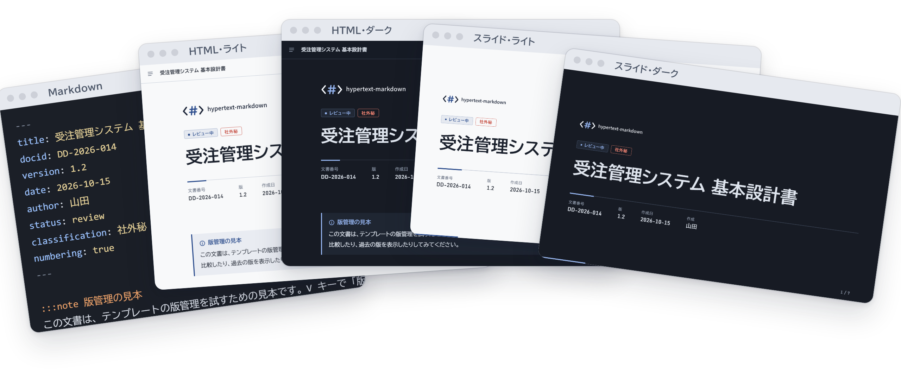
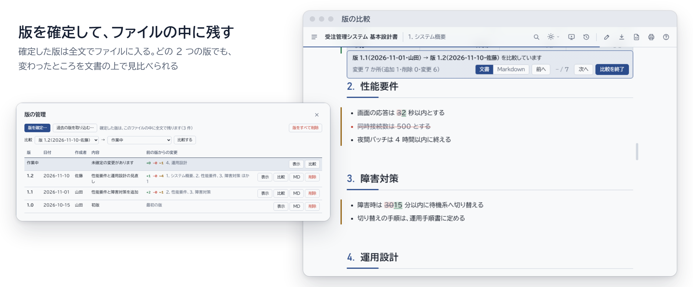

<h1 align="center">
  <picture>
    <source media="(prefers-color-scheme: dark)" srcset="docs/images/readme-title-dark.png">
    
  </picture>
</h1>

<p align="center">
  <a href="https://github.com/tsunyan/hypertext-markdown/actions/workflows/ci.yml"></a>
  <a href="https://github.com/tsunyan/hypertext-markdown/actions/workflows/codeql.yml"></a>
  <a href="LICENSE"></a>
  <a href="template-guide.min.html"></a>
  <a href="#ai-エージェントで使う"></a>
</p>

<p align="center">
  <picture>
    <source media="(prefers-color-scheme: dark)" srcset="docs/images/readme-views-dark.png">
    
  </picture>
</p>

<p align="center">
  <picture>
    <source media="(prefers-color-scheme: dark)" srcset="docs/images/readme-versions-dark.png">
    
  </picture>
</p>

<!-- 画像は python tools/make_readme_images.py で作り直す。画像の文言を変えたら、alt も合わせる -->

Markdown を内包した、1 つの HTML ファイルで配れる文書のテンプレート。調査メモや設計書を、目次・スライド・版の管理付きで読めるようにする。

- 本体: [template-guide.src.html](template-guide.src.html)
- 圧縮版: [template-guide.min.html](template-guide.min.html)。Node.js と npm がある環境で `python -I tools/minify_html.py` を実行すると、esbuild で CSS・JavaScript だけを圧縮して再生成する（初回はツールを取得する）。埋め込み Markdown と版データは保持する
- 使い方と全部品の見本はファイルの中に書いてある。ブラウザで開けばそのまま読める（<kbd>?</kbd> でショートカットの一覧、<kbd>E</kbd> で Markdown を表示）
- 版管理の見本: [samples/sample-versioned.src.html](samples/sample-versioned.src.html)（版 1.0〜1.2 と未確定の変更が入った基本設計書。<kbd>V</kbd> で版の一覧を開いて比較できる）
  - テンプレートを直したら、`python -I tools/make_sample.py template-guide.src.html samples/sample-versioned.src.html` で作り直す（テンプレートに入っている利用ガイドの版は持ち込まない）
- テンプレート自体にも、利用ガイドの見本の版（1.0・1.1）が入っている。中身は説明用で、実際の改版の経緯ではない
  - 新しい文書を作るときは、<kbd>V</kbd> の「版をすべて削除」で消す。`.md` をドロップしたときは、版を消すかを聞かれる
- 本文も版も入っていない空のテンプレート: [skills/hypertext-markdown/assets/template.html](skills/hypertext-markdown/assets/template.html)（開くと、`.md` のドロップか <kbd>E</kbd> で書き始めるよう案内する）

## AI エージェントで使う

AI エージェントがこのテンプレートで文書を作るためのスキルを、[skills/hypertext-markdown/](skills/hypertext-markdown/) に置いている。[skills.sh](https://skills.sh) の CLI で入れる（Node.js が必要）。

```bash
npx skills add tsunyan/hypertext-markdown
```

エージェントは Markdown を書き、スキルの `scripts/build.mjs` で空のテンプレートに流し込んで HTML にする。

| ファイル | 内容 |
|---|---|
| `SKILL.md` | 作る手順と、既存の HTML を直す手順 |
| `references/authoring.md` | 標準の Markdown にない書式（フロントマター、`:::` の部品、文中の記法、雛形） |
| `scripts/build.mjs` | `.md` を HTML にする。手元の画像を base64 で埋め込み、`</script>` を書き換え、`<title>` を文書名にする。`--extract` で HTML から Markdown を取り出し、`--template` と `--keep-versions` で既存の HTML を版を残したまま作り直す |
| `assets/template.html` | 空のテンプレート（`tools/make_skeleton.py` が作る） |

スキルを入れずに使うときも、Node.js があれば同じことができる。

```bash
node skills/hypertext-markdown/scripts/build.mjs report.md -o report.html
```

## できること

- ライト / ダーク / OS に合わせる、のテーマ切り替え（<kbd>T</kbd>）
- H2・H3 から目次を自動で作り、読んでいる位置に印を付ける。ツールバーには、いま読んでいる章と節（パンくず）を出す
- Markdown を内包し、そのままダウンロードできる（<kbd>D</kbd>）
- H2（または H3）ごとのスライド表示（<kbd>S</kbd>）。スライド中の印刷で 16:9 の PDF になる
- 読み物の印刷では、表紙・目次・本文の順に並び、ヘッダーに文書名と機密区分、フッターにページ番号が入る
- `.md` のドラッグ＆ドロップ、画面上での編集（<kbd>E</kbd>。画像の貼り付けも可）、HTML としての保存（<kbd>Ctrl</kbd>+<kbd>S</kbd>）
- 画像の埋め込み（base64、参照形式、ライト用とダーク用の出し分け）
- 文書の版管理（<kbd>V</kbd>）。確定した版を同じファイルに残し、版の間の変更を改訂線付きで比べる
- 文書内の検索（<kbd>/</kbd>）。閉じた折りたたみ・選んでいないタブ・ほかのスライドの中も探し、目次に章ごとの件数を出す
- コードの色分け（19 言語、外部ライブラリなし）、表の並べ替え・絞り込み・Excel 用のコピー、表からのグラフ、用語集
- 本文の幅を、右端の取っ手のドラッグで変える（見る人ごとにブラウザが覚える）
- フロントマターで、色の組み合わせ・強調の色・書体・ロゴを文書ごとに指定する

## 表現のための部品

Markdown で書けない見せ方は、`:::名前` 〜 `:::` の囲みで指定する。中身は普通の Markdown なので、ほかのビューアでも内容は読める。

| 分類 | 部品 |
|---|---|
| 流れ | `steps`（手順）、`flow`（工程の流れ）、`timeline`（時系列） |
| 並べる・比べる | `cards`、`columns`（幅の比を指定可）、`compare`（推奨を強調）、`pros-cons`、`tabs` |
| 強調 | `summary`（要旨）、`lead`（キーメッセージ）、`metrics`（数値）、`progress`（進捗バー） |
| 補足 | `note` `tip` `important` `warning` `caution`、`details`、`qa`（想定問答）、`quote`（出典付き引用） |
| 構成 | `figure` / `table`（図表番号）、`spec`（項目と値）、`tree`（ツリー） |
| 出し分け | `doc-only`（読み物だけ）、`slide-only`（スライドだけ） |
| 見本 | `example`（中身を描いた「表示」と、元の Markdown の「書き方」をタブで並べる。1 か所に書くので、見本と書き方がずれない） |
| グラフ | `chart`（中の表から、縦棒・横棒・積み上げ・折れ線・面・構成比を描く。「グラフ」と「データ」のタブ付き） |
| 用語 | `glossary`（用語集）、`*[略語]: 意味`（表示しない定義）。本文中の用語に、意味を添える |
| 文中 | `:ok[完了]` `:ng[]` `:warn[]` `:info[]` `:tag[]`（ラベル）、`:menu[設定 > ネットワーク]`（操作経路）、`[](#ID)`（図表番号・章番号への参照） |
| 自作 | 一覧に無い名前を付けると `c-名前` クラスの囲みになる。CSS を足せば独自デザインになる |

Zenn と同じ `:::message`・`:::details タイトル` も使える。

HTML も直接書ける。文の中のタグはそのまま残り、行の先頭をブロックのタグ（`<div>`・`<details>` など）で始めると、次の空行までが HTML になる。無害化はしないので、ほかの人から受け取った Markdown を開くときは中身を確かめる。

コードブロックの言語を `diff`（または `patch`）にすると、`git diff` の出力を GitHub の差分画面のように表示する。

- ファイルごとの枠（ファイル名、追加／削除／名前変更の区別、増減の行数とバー、折りたたみ）
- 「統合」と「左右」の切り替え（選んだ方法は保存する。`` ```diff split `` で最初から左右）
- 変更した行の中で、実際に変わった語の強調
- 変更前・変更後の行番号（行番号と `+` `-` は表示だけで、コピーすると元の差分のまま）
- スライドでは、表示中の方の表の行単位で分割する（続きの部分にもファイル名を付ける）
- 差分の中のコードも色分けする（言語はファイル名の拡張子から決める。`` ```diff lang=python `` で指定も可）

## コード・表・グラフ

- **コードの色分け:** C・C++、C#、Java、JavaScript、TypeScript、Python、シェル、バッチファイル、PowerShell、SQL、HTML、CSS、Markdown、JSON、XML、YAML、TOML、INI（conf・properties）、CSV・TSV（`` ```csv code ``）。外部ライブラリは使わず、言語ごとの規則で字句を分ける。色は行ごとに閉じるので、スライドでも行の単位で分けられる。`example` の「書き方」タブの Markdown も、中のフェンスの言語まで色分けする
- **CSV・TSV の表:** `` ```csv `` / `` ```tsv `` は表になる（引用符の中の区切り・改行・`""` に対応。数値だけの列は右揃え）。`noheader` で 1 行目も中身に、`title="…"` で表題を付ける
- **表の操作:** 見出しを押すと並べ替え（昇順 → 降順 → 元の順。数値の列は数値として比べる）。6 行以上の表には絞り込みの欄が付く。「コピー」でタブ区切り（Excel にそのまま貼れる形）にする。横にはみ出さない表は、スクロールしても見出しの行が画面の上に残る
- **グラフ:** `:::chart 種類 表題 unit=単位 min= max=`。種類は `bar`（省略時）・`barh`・`stacked`・`line`・`area`・`share`（`pie` も構成比の帯で描く）。系列の色は、構文強調の `--tk-c0`〜`--tk-c5`・`--tk-str`・`--tk-com` と共通の 8 色を決まった順で使い、ライト・ダーク表示に追従する。9 系列目以降は描かない。2 系列以上は凡例を付け、マウスを重ねるかキーボードで選ぶと値が出る。表示する幅に合わせて描き直し、スライドでは拡大する
- **用語集:** `:::glossary` の項目と `*[略語]: 意味` の語に、本文中で点線の下線を付け、マウスを重ねると意味を出す（H2 の章ごとに最初の 1 回だけ）。用語集の項目へは、押すと移動する

## 見た目の指定（フロントマター）

| キー | 内容 |
|---|---|
| `palette` | 色の組み合わせ。`indigo`（標準）・`blue`・`teal`・`green`・`wine`・`orange`・`purple`・`gray`（ライト用とダーク用の組） |
| `accent` | 強調の色を直接指定。`"#0f6e6e"`、またはダーク用も付けて `"#0f6e6e / #6fcfc9"`。`palette` より優先 |
| `font` / `mono` | 本文の書体（`gothic`・`ud`・`meiryo`・`yugothic`・`noto`・`system`・`mincho`、または書体名の並び）とコードの書体 |
| `logo` | 表紙の左上とスライドの下に出すロゴ。URL・`data:` URL・参照形式の名前（`[logo]: data:…` を末尾に書く） |

本文の幅は文書には持たせず、見る人ごとに変える（右端の取っ手をドラッグ。<kbd>←</kbd> <kbd>→</kbd> でも変えられ、ダブルクリックで標準の 46rem に戻る）。

## 画像

- ``。画像だけの段落は中央に置き、代替テキストがあれば表題にする（番号は `:::figure`）
- 1 つのファイルにまとめるときは base64 の `data:` URL で埋め込む。本文には `![構成図][arch]` と名前だけを書き、定義 `[arch]: data:image/png;base64,…` は末尾に置く（Markdown 標準の参照形式。リンクも `[文字][名前]` で書ける）
  - 定義とみなすのは、URL らしいもの（`data:`・`https://` などのスキーム、`./` などのパス、`arch.png` のようなファイル名）だけ。「`[注意]: 本文`」のような文は普通の段落のまま
- 編集欄（<kbd>E</kbd>）に画像を貼り付けるかドロップすると、上の形で自動的に埋め込む。画像は 1 枚ずつ段落にし、ファイル名を表題と定義の名前にする（クリップボードの画像は表題なし）
- URL の末尾に `#gh-light-mode-only` / `#gh-dark-mode-only` を付けた 2 枚を並べると、テーマに合わせて片方だけを表示する（GitHub と同じ書き方）。印刷ではライト用を使う
- SVG は本文に `<svg>` を直接書けば、`var(--accent)` などの色の変数と `currentColor` が効き、テーマに追従する。画像として埋め込んだ SVG には、ページの色の変数は届かない
- 保存した HTML には、画像が Markdown と描画済みの本文の 2 か所に入り、版を確定するたびに 1 回ずつ増える。base64 は元の約 1.33 倍になるので、画像は縮小してから入れる

## 文書の版管理

確定した版の Markdown を、同じ HTML ファイルの中に全文で残す（案 A：スナップショット方式）。差分は開くたびに計算する。

- **版を確定する:** <kbd>V</kbd> の「版を確定…」で版番号・日付・作成者・内容を入れると、いまの Markdown がその版として残り、HTML を保存する。フロントマターの `version` も書き換わる
- **比べる:** 任意の 2 つの版（作業中を含む）を比べる。文書として見るときは、変更した段落の左に改訂線を引き、変わった語を取り消し線と下線で示す。リストは項目、表は行の単位で比べる。目次の変更がある章に印が付き、<kbd>N</kbd> / <kbd>Shift</kbd>+<kbd>N</kbd> で変更の間を移動する。Markdown として見るときは、ソースコードの差分と同じ表示になる
- **過去の版を見る:** 読み取り専用で表示する。比較中・過去の版の表示中もスライドと印刷が使える（比較中の印刷は改訂線付き）
- **改版履歴:** 本文に `:::history` と書くと、確定した版の一覧が表になる
- **そのほか:** `.md` や保存済みの `.html` から過去の版を取り込める。版ごとの Markdown のダウンロードと削除、全部の版の削除もできる。版があるファイルに `.md` をドロップすると、新しい文書として版を消すか、同じ文書の続きとして残すかを聞く。表示は URL に残る（`#version=1.0`、`#compare=1.1..1.2`、作業中は `work`、Markdown の比較は `&md`）
- 章番号・図表番号・`[](#ID)` の参照は、章を足すと振り直されるため比較に含めない

ファイルの中では、確定した版を作業中の Markdown のすぐ後ろに新しい順で置く。

```html
<script type="text/markdown" id="md-source">（作業中の Markdown）</script>
<script type="text/markdown" class="md-version"
        data-version="1.1" data-date="2026-11-01" data-author="山田" data-note="性能要件を追加">（版 1.1 の全文）</script>
```

版は全文で残すので、ファイルは「本文 × 版の数」だけ大きくなる（本文 50KB × 10 版で 500KB 程度）。

## スライドが 1 枚に収まらないとき

1. 文字を 5% ずつ、80% まで縮める（`CONFIG.slideMinScale` で変更可）
2. それでも入らなければ、段落・リスト・表・コードの切れ目で次のスライドに送る。続きのスライドの見出しには「（続き）」を付ける
3. 大きな塊は単位ごとに分ける。表は行（見出しの行は毎回付ける）、リストは項目、コードは行、段落は文、`steps` などの囲みは項目、タブ（`example` を含む）は選んでいるタブの中身の塊。次のスライドに 1〜2 単位だけ残る分け方はしない
4. 図や画像のように分けられないものは、その図だけを縮める
5. 手で区切るなら `<!-- slide -->`（スライドだけ）か `<!-- pagebreak -->`（印刷も）

## 作りの要点

- **Markdown が正本。** 表示も、Markdown のダウンロードも、HTML の保存も、同じ Markdown から作る。HTML と Markdown の内容がずれない
- **外部依存なし。** Markdown の変換はファイル内の自前のパーサーで行う。CDN から読むのは Mermaid（図）だけで、SRI ハッシュ付き。スクリプト末尾の `CONFIG.mermaidSrc` を空にすれば通信しない
- **保存した HTML は、それだけで読める。** 描画済みの本文と図（SVG）も一緒に保存するので、JavaScript が無効な環境やオフラインでも本文と図が表示される（タブは全部のタブを並べて表示）
- **見た目の調整は CSS で行う。** テンプレートの `<style>` を変えた見た目は、保存しても引き継がれる。文書ごとの調整は Markdown の中に `<style>` を書く
- 日本語向けの調整: 記号の直後で閉じる `**「強調」**` が効く、日本語どうしの改行が余計な空白にならない、`.md` が Shift_JIS でも読める、`\` が `¥` に化けない

## 開発

変更はプルリクエストで main に入れる。CI では次の 4 つを確かめ、すべて通らないとマージできない。

| ジョブ | 内容 |
|---|---|
| `lint` | ruff（`tools/`・`tests/`）と `tools/check.py`。script 要素の壊れ（途中で閉じる、閉じずに後ろを飲み込む）、埋め込んだ JavaScript の構文、見本とスキルの空のテンプレートが作り直したものと同じこと、テンプレートの作業中の Markdown が見本の版 1.1 と同じこと、スキルの `authoring.md` に利用ガイドの囲みとフロントマターのキーが揃っていることを調べる |
| `tests` | Chromium でテンプレートと見本を開くテスト（`tests/test_smoke.py`）。エラーが出ないこと、図が描けること、すべてのスライドが 80% 以上で収まること（比較中も）、版の比較に印が付くこと、保存した HTML を開き直せること、JavaScript なしでも本文が読めること、スキルの `build.mjs` で作った HTML が元と同じように描けることを確かめる |
| `secrets` | gitleaks で、履歴全体から秘密情報を探す |
| `analyze` | CodeQL（HTML に埋め込んだ JavaScript、Python、ワークフロー） |

手元で同じ検査をするとき:

```bash
pip install -r requirements-dev.txt
python -m playwright install chromium
ruff check tools tests
python -I tools/check.py
python -m pytest -q
```

テンプレートの利用ガイドを直したら、同じ内容を見本の版 1.1 にも入れ、見本を作り直す。どちらかを忘れると `tools/check.py` が知らせる。

テンプレートを直したあとは、見本・圧縮版・スキルの空のテンプレートをこの順で作り直す（空のテンプレートは圧縮版から作る）。

```bash
python -I tools/make_sample.py template-guide.src.html samples/sample-versioned.src.html
python -I tools/minify_html.py
python -I tools/make_skeleton.py
```

AI エージェント向けの開発の約束は [AGENTS.md](AGENTS.md) にある。

## 確認したこと（2026-11-11）

Chrome（デスクトップ、ヘッドレス）とアプリ内ブラウザで確認した。

- 表示: ライト / ダーク、1366px 幅とスマホ幅（375px。段組み・比較・時系列は 1 列に、工程の流れは縦並びになり、横のはみ出しなし。グラフは 343px 幅で描き直す）
- 部品: 全部品の描画、タブの切り替え、図表番号と参照の置き換え
- コード・表・グラフ: 19 言語の色分け、差分の中の色分けと語単位の強調の重なり、CSV の表（右揃え・表題）、並べ替え（数値・文字・元の順）、絞り込み、タブ区切りのコピー、見出しの行の固定、5 種類のグラフとツールチップ（棒・帯は棒ごと、折れ線は縦の線）、用語の下線とツールチップ
- 検索: 全角・半角と大文字・小文字を区別しない一致、選んでいないタブの中の一致へ移るとタブが切り替わる、目次の件数、スライド中の検索
- 見た目の指定: `palette`・`font`・`logo`（表紙とスライドの下）、本文の幅のドラッグ・キー操作・標準に戻す操作と、保存した HTML に幅が残らないこと
- スライド: 利用ガイド（83 枚）で全スライドが 80% 以上で収まる。40 行の表、70 行のコード、14 項目の手順、30 項目のリスト、長い段落、縦長の画像を入れた文書で、分割と縮小が上の手順どおりに働く
- 保存した HTML: JavaScript ありでは描画済みの本文と図を再利用し、タブも切り替わる。JavaScript なしでも本文と図が読める
- 印刷: 読み物（ヘッダー・ページ番号・印刷用目次・折りたたみとタブの展開）、スライド（1 枚 1 ページ、1280×720px）
- オフライン: Mermaid を読めないとき、図のソースと理由を表示する
- 版管理（見本で確認）: 版の確定（入力の確認・番号の自動提案・保存時の書き出し）、版どうしと作業中との比較（文書・Markdown）、過去の版の表示、変更の間の移動、目次の印、URL からの表示の復元、保存して開き直したときの版の読み込み、HTML と Markdown からの取り込み、版の削除、比較中のスライド（はみ出しなし）と印刷、ダーク表示
- 版管理（テンプレートの見本の版で確認）: 改版履歴の自動作成、1.0 → 1.1 の比較（スライド 90 枚、すべて 80% 以上）、版 1.0 の表示、「版をすべて削除」、`.md` のドロップで版を消す場合と残す場合

Firefox と Safari では確かめていない。印刷のヘッダーとページ番号（`@page` の余白欄）は Chrome・Edge のみ対応。

## ライセンス

MIT（[LICENSE](LICENSE)）
