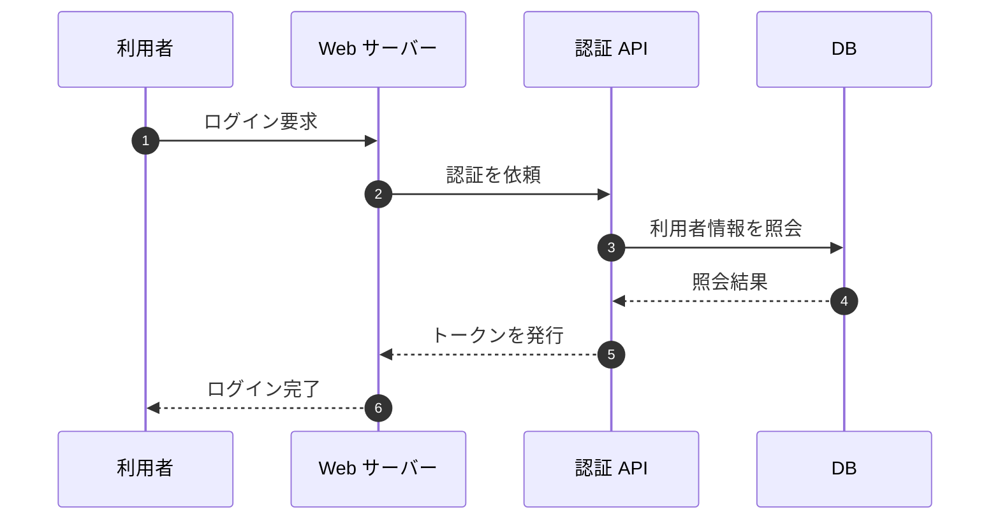

Markdown で本文を書き、読む・発表する・配るための HTML にまとめます。このガイドでは、短い報告書をひとつ作り、表現や見た目を整え、改版するところまで進めます。

| 読みたいこと | 入口 |
|---|---|
| 初めて文書を作る | [第1部：最初の文書を作る](#part-start) |
| 文書を仕上げて使い続ける | [第2部：文書を育てる](#part-practice) |
| 書式・設定・操作を調べる | [第3部：目的から引くリファレンス](#part-reference) |

:::tip 見本を試す
見本の「書き方」タブで元の Markdown を確認できます。部品名が分かっているときは[名前から探す](#ref-index)、文書内を検索するときは <kbd>/</kbd> を使ってください。
:::

## 最初の文書を作る {#part-start}

ここでは「問い合わせ対応の改善報告」を作ります。最初は見出しと短い本文だけで十分です。

:::flow
- **書く**
  Markdown で内容をまとめる
- **確かめる**
  ブラウザで表示する
- **渡す**
  HTML を保存して共有する
:::

### 文書の仕組みを知る

ひとつの HTML に、元の Markdown と表示に必要な CSS・JavaScript が入っています。読むための専用アプリやサーバーは要りません。本文を直すときは Markdown を編集し、同じ内容を読み物・スライド・PDFに使います。

読み物では見出しから目次を作り、スライドでは見出しごとにページを分けます。印刷もそれぞれの表示に合わせて整います。別々の資料を書き直す必要はありません。

### 短い報告書を書く {#start-write}

[空のテンプレート](https://tsunyan.github.io/hypertext-markdown/skills/hypertext-markdown/assets/template.html)をブラウザで開き、<kbd>E</kbd> で編集欄を開きます。次の Markdown を貼り付けてください。

~~~~markdown
# 問い合わせ対応の改善報告

## 結論
よくある質問をまとめ、回答にかかる時間を減らします。

## 調べたこと
問い合わせ記録を確認すると、同じ質問への回答が繰り返されていました。

## 次に行うこと
- よくある質問を10件選ぶ
- 回答をまとめてチームで試す
- 1か月後に効果を確認する
~~~~

`#` は文書名、`##` は章の見出し、`-` は箇条書きです。入力した内容は右側に反映され、章の見出しが目次に並びます。

すでに `.md` がある場合は、ファイルを画面へドロップしても始められます。このガイドを使って作る場合は、版を消すか聞かれたら削除を選び、説明用の版 1.0・1.1 を引き継がないようにします。

### 表示を確かめて保存する {#start-save}

:::steps
1. **読み物として見る**
   編集欄を閉じ、目次から「次に行うこと」へ移動します。<kbd>T</kbd> でライト・ダークの見え方も確認できます。
2. **スライドにする**
   <kbd>Shift</kbd>+<kbd>S</kbd> で表紙から始め、矢印キーで進めます。<kbd>Esc</kbd> で読み物に戻ります。
3. **HTML を保存する**
   <kbd>Ctrl</kbd>+<kbd>S</kbd> を押します。ブラウザが HTML をダウンロードします。
:::

保存は、開いているファイルの直接上書きではありません。ダウンロードした HTML を開き直し、書いた内容が残っていることを確認してください。

### HTML を相手に渡す

保存した HTML を渡せば、相手もブラウザで読めます。次の一言を添えると、使い方が伝わります。

> HTML をブラウザで開いてください。左側の目次で移動でき、S キーでスライド、Ctrl+P で印刷・PDFにできます。

ブラウザから保存した HTML には、描画済みの本文も含まれます。JavaScript が動かない環境でも本文を読めますが、検索や編集などの操作には JavaScript が必要です。画像や図を加えた文書の渡し方は、[配布に備える](#practice-delivery)で扱います。

## 文書を育てる {#part-practice}

第1部の報告書に、表紙の情報・比較・グラフを加えて仕上げます。必要なところだけ取り入れてください。書式の全項目は第3部から引けます。

### 表紙と章立てを整える {#practice-structure}

冒頭の `# 問い合わせ対応の改善報告` を、次のフロントマターに置き換えます。その下に「結論」「調べたこと」「次に行うこと」の本文を残します。

```yaml
---
title: 問い合わせ対応の改善報告
subtitle: チームで試すFAQの提案
author: 山田
status: draft
numbering: true
filename: support-report
---
```

文書名・副題・作成者が表紙にまとまり、章には番号が付きます。章の中を分けるときは `###` を使います。フロントマターの `title` と本文の `#` に同じ文書名を重ねて書く必要はありません。

[フロントマター](#ref-frontmatter)では、日付・機密区分・承認者なども指定できます。別の用途から始める場合は[文書の雛形](#ref-starters)を使えます。

### 結論と根拠を見せる {#practice-expression}

「結論」の文章を `summary` で囲みます。要点を先に示し、その後に根拠を並べると、読み手が判断しやすくなります。

::::example
:::summary 提案
よくある質問を10件にまとめ、チーム内で1か月試します。回答時間と更新の手間を見て、継続するか判断します。
:::
::::

「調べたこと」には、選択肢の比較を加えます。見出しの `{.best}` は推奨する案を示します。

::::example
:::compare
#### 個別の回答を続ける
- 準備は不要
- 同じ回答を繰り返す

#### FAQを共有する {.best}
- 最初に回答を整理する
- 更新する担当者を決める
:::
::::

`summary` と `compare` は表現のための囲みです。最初から多くの部品を使う必要はありません。順序を示したいなら[手順と流れ](#ref-flow)、注意を添えたいなら[補足と根拠](#ref-notes)を選びます。

### 数値と図を加える {#practice-data}

効果を記録できたら、「調べたこと」に表やグラフを加えます。次は説明用の数値です。実際の報告では、自分の調査結果に置き換えてください。

::::example
:::chart bar 回答にかかった平均時間 unit=分
| 期間 | 時間 |
|---|---:|
| 導入前 | 12 |
| 試行中 | 8 |
:::
::::

数値を正確に読んでほしいときは表、大小や変化を伝えたいときはグラフを使います。グラフの「データ」タブから元の表も読めます。

画面の説明には、編集欄へスクリーンショットを貼り付けます。画像が文書に埋め込まれ、別の画像ファイルを渡す必要がなくなります。[画像と図](#ref-media)には図表番号やテーマに合わせた画像の切り替えも載せています。

### 配色・書体・ロゴを整える {#practice-look}

報告書のフロントマターに `palette: teal` と `font: gothic` を追加すると、配色と本文の書体を揃えられます。<kbd>T</kbd> でライト・ダークを切り替えて確認してください。

ロゴを使う場合は `logo` で指定します。配布先でも同じ画像を表示するには、画像を埋め込んで使います。書体は相手の PC にあるものが使われるため、見た目は環境によって変わります。

色を直接指定する方法や選べる書体は[色・書体・ロゴ](#sec-look)で調べられます。

### 会議とPDFで使う {#practice-present}

報告書を <kbd>Shift</kbd>+<kbd>S</kbd> で開き、結論・根拠・次の行動の順に話せるか確かめます。スライドが何枚も続く章は、伝えたいことごとに見出しを分けると整理できます。

詳しい説明を読み物に残し、発表では要点だけにしたい場合は、次のように書きます。

::::example
:::doc-only
試行期間中は、担当者が週に一度回答を見直し、問い合わせ記録と照合して不足を補います。
:::

:::slide-only
週に一度、FAQを見直します。
:::
::::

読み物の状態で <kbd>Ctrl</kbd>+<kbd>P</kbd> を押すと、表紙・目次・本文の PDF にできます。スライドの状態なら 16:9 の 1 枚を 1 ページにします。細かな区切り方は[表示と印刷を制御する](#ref-output)で確認できます。

### 配布に備える {#practice-delivery}

画像や図を加えたら、描画が終わってから HTML を保存し、保存したファイルを開き直します。

| 渡す形 | 向いている使い方 |
|---|---|
| HTML | 目次・検索・スライドを使って読む。版も一緒に渡す |
| PDF | 決まったレイアウトで読む・印刷する |
| Markdown | 別のエディタで編集する。<kbd>D</kbd> で取り出す |

Mermaid の図は、初めて描くときに通信が必要です。描画後にブラウザから保存すれば、図も HTML に残ります。外部 URL の画像は保存しても自動では埋め込まれないため、ファイルだけで配るなら編集欄への貼り付けなどで埋め込んでください。

画像は表示に必要な大きさまで縮小すると、扱いやすいファイルになります。保存方式ごとの違いは[保存・読み込み・オフライン](#ref-files)にまとめています。

### 修正して版を残す {#practice-version}

最初の報告書を共有する時点で、<kbd>V</kbd> から「版を確定…」を開き、版番号を `1.0` として保存します。その後、試行結果を追記して `1.1` を確定します。

版の管理で 1.0 と 1.1 を比べると、変わった段落と語が分かります。「作業中」と確定した版の比較もできるため、次の共有前に変更を確認できます。

本文に次の囲みを加えると、確定した版から改版履歴を作れます。

```markdown
:::history
:::
```

版を残す操作と普段の保存は別です。日々の修正は <kbd>Ctrl</kbd>+<kbd>S</kbd>、共有や承認の区切りで版を確定します。取り込み・削除・比較表示の詳細は[版を管理する](#sec-versions)へ進んでください。

## 目的から引くリファレンス {#part-reference}

ここからは、必要な項目を選んで読めます。各項目に使いどころ、見本、設定や挙動をまとめています。

### 名前から探す {#ref-index}

| 目的 | 書式・設定 |
|---|---|
| 文書全体を設定する | [フロントマター](#ref-frontmatter)、[palette・accent・font・mono・logo](#sec-look) |
| 本文を書く | [見出し・段落・リスト・リンク・文字装飾](#ref-text)、[ラベル・操作経路](#ref-inline) |
| 囲みを使う | [共通の書き方・example](#sec-blocks) |
| 要点を伝える | [summary・lead](#ref-summary) |
| 流れを示す | [steps](#sec-steps)、[flow](#ref-flow-block)、[timeline](#ref-timeline) |
| 並べる・比較する | [cards](#ref-cards)、[columns](#ref-columns)、[compare](#ref-compare)、[pros-cons](#ref-pros-cons)、[tabs](#ref-tabs) |
| 数値を見せる | [表・CSV・TSV](#ref-table)、[metrics・progress](#ref-metrics)、[chart](#sec-chart)、[spec](#ref-spec) |
| 図・コードで説明する | [画像・SVG](#sec-images)、[Mermaid](#ref-mermaid)、[figure・table・参照](#ref-figures)、[tree](#ref-tree)、[コード](#ref-code)、[diff・patch](#ref-diff) |
| 補足・根拠を添える | [note・tip・important・warning・caution・details](#ref-callouts)、[message](#ref-message)、[qa](#ref-qa)、[quote](#ref-quote)、[脚注](#ref-footnotes)、[glossary・略語](#sec-glossary) |
| 表示を制御する | [doc-only・slide-only・改ページ・スライド](#ref-output)、[HTML・独自の囲み](#sec-html) |
| 保存・改版する | [HTML・Markdown・画像の保存](#ref-files)、[版の管理・history](#sec-versions) |
| 操作を調べる | [ショートカットと閲覧操作](#ref-controls)、[困ったとき](#ref-help)、[雛形](#ref-starters) |

### フロントマター {#ref-frontmatter}

本文の先頭に `---` で囲んで書きます。どの項目も省略できます。

| キー | 内容 | 例 |
|---|---|---|
| `title` | 文書名。無ければ先頭の `# 見出し` を使う | 〇〇システム 基本設計書 |
| `subtitle` | 副題 | |
| `docid` / `version` | 文書番号・版 | 1.0 |
| `date` / `updated` | 作成日・更新日 | 2026-11-10 |
| `author` / `reviewer` / `approver` | 作成・レビュー・承認 | |
| `status` | `draft` / `review` / `approved` / `final` / `obsolete` | review |
| `classification` | 機密区分。表紙と印刷時のヘッダーに出る | 社外秘 |
| `numbering` | `true` で H2・H3 に章番号を振る | true |
| `slide_level` | `3` で H3 でもスライドを分ける | 2 |
| `h2_pagebreak` | `true` で印刷時に H2 の前で改ページ | false |
| `filename` | 保存するときのファイル名（拡張子なし） | design-v1 |
| `palette` | 色の組み合わせ（[](#sec-look)） | teal |
| `accent` | 強調の色を直接指定（[](#sec-look)） | "#0f6e6e" |
| `font` / `mono` | 本文の書体・コードの書体（[](#sec-look)） | ud |
| `logo` | 表紙とスライドの下に出すロゴ（[](#sec-look)） | logo |

表に無いキー（`customer: 〇〇株式会社` など）も、表紙の欄にそのまま並びます。章番号を付けたくない見出しは、`## 改版履歴 {-}` のように末尾に `{-}` を付けます。見出しに `{#ID}` を付けると、その ID で参照できます。

設定は `キー: 値` を 1 行ずつ書きます。値の入れ子や配列を使う YAML ではありません。`numbering` と `h2_pagebreak` は省略時に無効、`slide_level` は省略時に `2` です。

| キー | 内容 | 例 |
|---|---|---|
| `breaks` | `true` で、段落内の通常の改行も表示に反映する。省略時は無効 | true |

#### 色・書体・ロゴ {#sec-look}

会社や案件ごとの見た目は、フロントマターで指定します。

~~~markdown
---
title: 〇〇システム 基本設計書
palette: teal
font: ud
logo: logo
---

（本文）

[logo]: data:image/png;base64,iVBORw0…
~~~

- **`palette`（色の組み合わせ）:** リンク、章番号、目次の印、タブ、スライドの見出しの線など、強調に使う色が変わります。ライト用とダーク用の色を組にしてあります（下の表）
- **`accent`（色を直接指定）:** `accent: "#0f6e6e"` のように 1 色を書くと、ダーク用はその色を明るくして作ります。両方を決めるときは `accent: "#0f6e6e / #6fcfc9"` と書きます。`palette` と両方あるときは `accent` が優先です
- **`font`（本文の書体）:** `gothic`（標準）・`ud`（BIZ UD ゴシック）・`meiryo`・`yugothic`・`noto`（Noto Sans JP）・`system`・`mincho`（明朝）から選ぶか、`font: "Noto Sans JP", sans-serif` のように書体名を並べます。見る人のパソコンに入っている書体だけが使われます
- **`mono`（コードの書体）:** `mono: "Cascadia Code", Consolas` のように書体名を並べます
- **`logo`（ロゴ）:** 表紙の左上と、スライドの下（表紙のスライドを除く）に出ます。URL・`data:` URL のほか、上のように参照形式の名前を書くと本文の末尾の定義を使うので、長い base64 をフロントマターに書かずに済みます

ロゴや favicon を手元の画像から埋め込む場合は、リポジトリに付属するコマンドも使えます。Node.js 18 以上の環境で、次のように指定します。

```bash
node skills/hypertext-markdown/scripts/build.mjs report.md --logo ./logo.svg --logo-dark ./logo-dark.svg --favicon ./favicon.png --favicon ./favicon.svg
```

画像のパスは実行フォルダ基準です。`--logo` だけなら明暗共通になり、`--logo-dark` を添えるとダーク用を分けられます。`--favicon` は SVG・PNG・ICO を複数指定でき、既存の favicon 一式を置き換えます。画像は HTML に埋め込まれるので別添は不要です。フロントマターに `logo` がある場合は、そちらが優先されます。

| `palette` | ライト | ダーク |
|---|---|---|
| `indigo`（標準） | <span class="swatch" style="--c:#2b4c8c"></span>`#2b4c8c` | <span class="swatch" style="--c:#93b2ec"></span>`#93b2ec` |
| `blue` | <span class="swatch" style="--c:#1f5fbf"></span>`#1f5fbf` | <span class="swatch" style="--c:#8ab4f8"></span>`#8ab4f8` |
| `teal` | <span class="swatch" style="--c:#0f6e6e"></span>`#0f6e6e` | <span class="swatch" style="--c:#6fcfc9"></span>`#6fcfc9` |
| `green` | <span class="swatch" style="--c:#2c6e3f"></span>`#2c6e3f` | <span class="swatch" style="--c:#7fcf96"></span>`#7fcf96` |
| `wine` | <span class="swatch" style="--c:#8c2b4c"></span>`#8c2b4c` | <span class="swatch" style="--c:#f0a0b8"></span>`#f0a0b8` |
| `orange` | <span class="swatch" style="--c:#a4501a"></span>`#a4501a` | <span class="swatch" style="--c:#f2a66b"></span>`#f2a66b` |
| `purple` | <span class="swatch" style="--c:#5b3aa0"></span>`#5b3aa0` | <span class="swatch" style="--c:#c2a6f5"></span>`#c2a6f5` |
| `gray` | <span class="swatch" style="--c:#3d4654"></span>`#3d4654` | <span class="swatch" style="--c:#b6bfcc"></span>`#b6bfcc` |

### 本文を書く・参照する {#ref-text}

#### 見出し・段落・改行

文書名はフロントマターの `title`、または本文先頭の `#` 見出しに書きます。章は `##`、節は `###` にすると目次に載ります。`####` 以下は本文内の小見出しに使います。

段落の間には空行を入れます。通常の改行は段落内でつながり、日本語どうしでは余計な空白を入れません。明示的に改行する場合は行末に半角スペースを2つ置くか `<br>` を使います。全体で改行を生かしたい場合は `breaks: true` を指定します。

~~~~markdown
## 調査結果 {#results}

ここが最初の段落です。

### 対応時間
回答を探す時間が短くなりました。

[調査結果へ戻る](#results)
~~~~

`{#results}` は移動先の ID です。`numbering: true` の文書で `[](#results)` と書くと章番号の参照になります。見出し末尾の `{-}` は、その見出しを章番号の対象から外します。

#### リスト・引用・区切り

:::example
- 準備する
  - 対象を決める
  - 記録を集める

1. 内容を確認する
2. 共有する

> 引用した文章をここに書きます。

---

区切りの後の段落です。
:::

#### リンクと参照形式

`[表示する文字](URL)` でリンクにします。URL をそのまま書いてもリンクになります。同じ宛先を繰り返すときは、名前を付けた参照形式も使えます。

```markdown
[詳細な資料][source]

[source]: https://example.com/report
```

定義の URL は `https://` や `data:`、相対パスなどで書きます。`[注意]: 本文` のように URL ではない文は定義になりません。

#### 文字の装飾 {#ref-decoration}

日本語の文中でも、`**「強調」**` のように記号の直後で閉じた強調がそのまま効きます。URL はそのまま書いてもリンクになります。

:::example
**太字**、*斜体*、~~取り消し線~~、==蛍光ペン==、`インラインコード`、<kbd>Ctrl</kbd>+<kbd>C</kbd>、[リンク](https://example.com)、https://example.com/docs

日本語の文中でも、**「強調」**のように効きます。
:::

#### 文中のラベルと画面操作の経路 {#ref-inline}

状態を表すラベルは `ok`・`warn`・`ng`・`info`・`tag` の 5 種類です。画面の操作経路は `>` で区切って書きます。表の中でも使えます。

:::example
:ok[完了] :warn[保留] :ng[未対応] :info[確認中] :tag[任意]

:menu[設定 > ネットワーク > プロキシ] を開く

| 課題 | 状態 | 担当 |
|---|---|---|
| ログの保存期間の決定 | :ok[完了] | 運用チーム |
| 夜間バッチの所要時間 | :warn[保留] | 開発チーム |
| 帳票の文字化け | :ng[未対応] | 開発チーム |
:::

#### チェックリスト {#ref-checklist}

:::example
- [x] 要件定義書のレビュー
- [x] 方式設計
- [ ] 性能試験
  - [ ] 負荷シナリオの作成
  - [ ] 実施と報告
:::

### 囲みの共通書式 {#sec-blocks}

Markdown だけでは表しにくい見せ方を、`:::名前` から `:::` までの囲みで指定します。中身には通常の Markdown を使えます。対応していないビューアでは囲みの記号が表示されますが、元の文章は読めます。

```markdown
:::note 確認事項 {#check .c-check}
ここに本文を書きます。
:::
```

名前の後ろには、部品に応じてタイトル・見出し・表題・出典を書きます。`{#ID .クラス}` で ID とクラスを指定できます。独自の装飾には `c-` で始まるクラス名を使います。

囲みを入れ子にするときは、外側を `::::` のように長くして閉じる位置を区別します。

#### 表示と書き方を並べる（example） {#ref-example}

操作説明や書式の見本に使います。`example` の中身を一度だけ書くと、描画した「表示」と元の Markdown の「書き方」をタブで並べます。

::::example
:::note
この囲みも、表示と書き方を切り替えられます。
:::
::::

### 要点を伝える {#ref-keypoints}

結論や判断に必要な一文を、本文から見つけやすくします。数値そのものを強調したい場合は [metrics](#ref-metrics) を使います。

#### 要旨とキーメッセージ（summary・lead） {#ref-summary}

`summary` は文書の冒頭に置く要旨、`lead` はスライドで大きく見せたい一文に使います。

::::example
:::summary
現行システムは 2027 年 3 月に保守が切れるため、2026 年度中にクラウドへ移行する。5 年間の費用は約 15% 下がる見込み。
:::

:::lead
移行の目的は、保守切れへの対応と、運用の手間を半分にすることです。
:::
::::

### 手順・流れ・経緯を示す {#ref-flow}

実行する順序は `steps`、工程全体のつながりは `flow`、日時を伴う経緯は `timeline` を使います。

#### 手順（steps） {#sec-steps}

番号付きリストを、番号と縦線でつないだ手順として見せます。

::::example
:::steps
1. **サービスを停止する**
   `systemctl stop app.service` を実行する
2. **バックアップを取る**
   設定ファイルとデータベースを退避する
3. **パッチを適用する**
   適用後に `app --version` で版を確かめる
:::
::::

#### 工程の流れ（flow） {#ref-flow-block}

工程や処理の流れを、矢印でつないで横に並べます。狭い画面では縦に並びます。

::::example
:::flow
- **要件定義**
  業務と要件を整理
- **設計**
  方式と機能を決める
- **実装**
  開発と単体試験
- **試験**
  結合・総合試験
- **移行**
  本番環境へ切り替え
:::
::::

#### 時系列（timeline） {#ref-timeline}

障害報告の経緯や、プロジェクトの予定に使います。

::::example
:::timeline 障害の経緯
- **11/10 09:00** 監視で応答の遅れを検知
- **09:15** DB の接続数が上限に達していることを確認
- **09:40** 接続プールの設定を変更して復旧
- **10:30** 恒久対策の検討を開始
:::
::::

### 並べる・比較する {#ref-compare-group}

同列の話題はカード、自由な横並びは段組み、選択肢の評価は比較を使います。タブは必要な内容を選んで読む場面に向きます。どの選択肢も同時に見てほしい場合は、比較や段組みを使ってください。

#### カード（cards） {#ref-cards}

並列の項目をカードで並べます。リストのほか、見出しごとに書けば中に表やコードも入れられます。

::::example
:::cards
- **可用性** 冗長構成にして、年間の停止時間を 4 時間以内にする
- **性能** 利用が集中する時間帯でも、画面の応答を 2 秒以内にする
- **保守性** 設定の変更を、プログラムの修正なしで行えるようにする
:::
::::

#### 段組み（columns） {#ref-columns}

`---` で区切った部分を横に並べます。`:::columns 1:2` のように幅の比も指定できます。

::::example
:::columns 1:1
**現行の課題**

- サーバーの保守期限が近い
- 手作業の運用が多い

---

**移行後の姿**

- 基盤の保守が不要になる
- 定型作業を自動化する
:::
::::

#### 案の比較（compare） {#ref-compare}

見出しごとに案を並べます。見出しの末尾に `{.best}` を付けた案は、推奨として強調します。

::::example
:::compare
#### 案A オンプレミス継続
- 初期費用：小
- 運用の手間：大

#### 案B クラウド移行 {.best}
- 初期費用：中
- 運用の手間：小

#### 案C ハイブリッド
- 初期費用：大
- 運用の手間：中
:::
::::

#### メリット・デメリット（pros-cons） {#ref-pros-cons}

`---` の前がメリット、後ろがデメリットです。見出しを書けば、その見出しに置き換わります。

::::example
:::pros-cons
- 基盤の保守が不要になる
- 需要に応じて性能を変えられる

---

- 通信費が増える
- 監視の仕組みを作り直す必要がある
:::
::::

#### タブ（tabs） {#ref-tabs}

見出しごとにタブにします。OS や環境ごとに手順が違うときに使います。印刷では全部のタブを並べます。

::::example
:::tabs
#### Windows

```powershell
Get-Service app
```

#### Linux

```bash
systemctl status app
```
:::
::::

### 数値・データを見せる {#ref-data}

正確な値は表、傾向はグラフ、注目する数値は `metrics`、完了の割合は `progress` で示します。

#### 表 {#ref-table}

区切りの行の `:` の位置で、列を左・中央・右に揃えます。

:::example
| 項目 | 現行 | 移行後 | 備考 |
|:---|:---:|---:|---|
| OS | RHEL 7 | RHEL 9 | サポート終了への対応 |
| DB | Oracle 12c | PostgreSQL 16 | 移行ツールで変換 |
| 月額費用（円） | 1,200,000 | 850,000 | 税抜 |
:::

表の見出しを押すと、その列で並べ替えます（昇順 → 降順 → 元の順）。6 行以上の表には絞り込みの欄が付き、入れた文字を含む行だけを残します。「コピー」を押すと、Excel にそのまま貼れる形（タブ区切り）でコピーします（行の少ない表では、マウスを重ねると右上に出ます）。横にはみ出さない表は、下へスクロールしても見出しの行が画面の上に残ります。

表は `` ```csv ``（タブ区切りなら `` ```tsv ``）でも書けます。1 行目が見出しで、数値だけの列は右に揃えます。引用符で囲めば、中に「,」や改行を入れられます。1 行目も中身として扱うときは `` ```csv noheader ``、ソースのまま色分けして見せるときは `` ```csv code `` と書きます。

:::example
```csv title="サーバー一覧"
ホスト名,役割,CPU,メモリ,OS
web01,Web,4,8GB,RHEL 9
web02,Web,4,8GB,RHEL 9
ap01,AP,8,32GB,RHEL 9
ap02,AP,8,32GB,RHEL 9
db01,"DB（主）",16,128GB,RHEL 9
db02,"DB（従）",16,128GB,RHEL 9
bat01,バッチ,4,16GB,RHEL 8
```
:::

#### 数値と進捗（metrics・progress） {#ref-metrics}

`metrics` は先頭の太字を大きな数値として、`progress` は末尾の割合を進捗バーとして見せます。

::::example
:::metrics
- **99.95%** 月間の可用性
- **1.2 秒** 平均の応答時間
- **−18%** 前年比の運用費
:::

:::progress 移行作業の進捗
- 設計 100%
- 環境構築 80%
- データ移行 35%
- 試験 0%
:::
::::

#### グラフ（chart） {#sec-chart}

`:::chart 種類 表題` の中に表を書くと、グラフにします。「グラフ」と「データ」のタブが付き、データのタブで元の表を見られます。マウスを重ねる（キーボードなら <kbd>Tab</kbd> で選ぶ）と値が出ます。

| 種類 | 見せ方 | 向いている場面 |
|---|---|---|
| `bar`（省略時） | 縦棒 | 項目ごとの大きさを比べる |
| `barh` | 横棒 | 項目名が長いとき、項目が多いとき |
| `stacked` | 積み上げの縦棒 | 合計と内訳を一度に見せる |
| `line` | 折れ線 | 時間による変化 |
| `area` | 面 | 時間による変化と、量の大きさ |
| `share`（`pie` でも可） | 構成比の帯 | 全体に占める割合（6 項目くらいまで） |

- 表の 1 列目が項目、2 列目以降が系列です。Markdown の表のほか、`` ```csv `` でも書けます
- `unit=万円` で単位を付けます。書かなければ、数値の後ろにそろって付いている単位（`%` など）を使います
- `min=0 max=100` で縦軸（横棒は横軸）の範囲を決められます
- 色は系列の順に、決まった順番で付きます（構文強調の `--tk-...` と同じ配色）。9 系列目以降は描きません
- 円グラフは近い値の大小が読み取りにくいため、`pie` と書いても構成比の帯で描きます

::::example
:::chart line 画面の平均応答時間 unit=秒
| 月 | 本番 | 検証 |
|---|---:|---:|
| 4月 | 1.4 | 2.3 |
| 5月 | 1.2 | 2.0 |
| 6月 | 1.1 | 1.8 |
| 7月 | 0.9 | 1.6 |
| 8月 | 0.8 | 1.5 |
:::
::::

::::example
:::chart stacked 月別の問い合わせ件数
```csv
月,障害,操作,要望
4月,12,30,8
5月,9,26,11
6月,7,22,9
7月,5,25,12
```
:::
::::

::::example
:::chart share 開発費の内訳 unit=万円
| 費目 | 金額 |
|---|---:|
| 人件費 | 1800 |
| ライセンス | 420 |
| 機器 | 260 |
| その他 | 120 |
:::
::::

#### 項目と値（spec） {#ref-spec}

設定値や仕様の一覧に使います。「**項目**：値」か「項目：値」で書きます。

::::example
:::spec サーバーの構成
- **OS**：Red Hat Enterprise Linux 9.4
- **CPU / メモリ**：4 vCPU / 16 GB
- **ミドルウェア**：PostgreSQL 16、nginx 1.26
:::
::::

### 図・画像で説明する {#ref-media}

画面の説明には画像、処理の関係には Mermaid、階層にはツリーを使います。本文から呼び出したい図や表には番号と ID を付けます。

#### 画像 {#sec-images}

`` と書きます。画像だけの段落は中央に置き、代替テキストを表題として下に出します。番号を付けるときは `:::figure` で囲みます。

- **ファイル 1 つにまとめる:** 画像を base64 の `data:` URL にして埋め込みます。本文が読みにくくならないよう、本文には `![構成図][arch]` と名前だけを書き、`[arch]: data:image/png;base64,…` の定義を Markdown の末尾に置く書き方（参照形式）がおすすめです
- **編集欄に貼り付ける:** 編集欄（<kbd>E</kbd>）に画像を貼り付けるかドロップすると、この形で自動的に埋め込みます
- **ライト用とダーク用:** URL の末尾に `#gh-light-mode-only` と `#gh-dark-mode-only` を付けた 2 枚を並べると、テーマに合わせて片方だけを表示します（GitHub と同じ書き方）。印刷ではライト用を使います

:::example
![Web・AP・DB の構成][arch]
![Web・AP・DB の構成][arch-dark]

[arch]: #gh-light-mode-only
[arch-dark]: #gh-dark-mode-only
:::

SVG は、本文に `<svg>` を直接書くこともできます。本文の一部になるので、`var(--accent)` などの色の変数や `currentColor` が使え、テーマを切り替えると色も変わります。途中に空行を入れないでください（空行で HTML のかたまりが終わるため）。

:::example
<svg width="300" height="64" viewBox="0 0 300 64" role="img" aria-label="Web から AP、DB への流れ" style="display:block;margin:0 auto" font-size="14" fill="currentColor">
  <rect x="2" y="12" width="72" height="40" rx="5" fill="var(--bg-sunken)" stroke="var(--accent)" stroke-width="1.5"/><text x="38" y="37" text-anchor="middle">Web</text>
  <rect x="114" y="12" width="72" height="40" rx="5" fill="var(--bg-sunken)" stroke="var(--accent)" stroke-width="1.5"/><text x="150" y="37" text-anchor="middle">AP</text>
  <rect x="226" y="12" width="72" height="40" rx="5" fill="var(--bg-sunken)" stroke="var(--accent)" stroke-width="1.5"/><text x="262" y="37" text-anchor="middle">DB</text>
  <path d="M80 32h22m-6-5 6 5-6 5M192 32h22m-6-5 6 5-6 5" fill="none" stroke="var(--accent)" stroke-width="1.5"/>
</svg>
:::

:::warning 画像の大きさに注意
保存した HTML には、画像が Markdown と描画済みの本文（JavaScript なしでも読めるようにするためのもの）の 2 か所に入ります。版を確定すると、版ごとにもう 1 回入ります。base64 にすると元の約 1.33 倍になるので、画像は縮小してから入れてください。
:::

#### 図（Mermaid） {#ref-mermaid}

コードブロックの言語を `mermaid` にすると図になります。初回の描画には CDN からのライブラリ読み込みが必要です。描画後に HTML を保存すれば、その図をオフラインでも読めます。読み込めない場合は図のソースと理由を表示します。

::::example
:::figure {#fig-login} ログイン処理の流れ

:::
::::

#### 図表番号と参照（figure・table） {#ref-figures}

`figure` と `table` で囲むと、「図 1」「表 1」のように番号が振られます。表題は、日本語の文書の慣習どおり図は下、表は上に付きます。ID を付けておけば、本文に `[](#ID)` と書くだけで番号に置き換わります。たとえば [](#fig-login) は、このガイドの Mermaid の見本です。

::::example
:::table {#tbl-env} 環境ごとの台数
| 環境 | Web | AP | DB |
|---|---:|---:|---:|
| 本番 | 2 | 2 | 2 |
| 検証 | 1 | 1 | 1 |
:::

台数は [](#tbl-env) のとおりです。
::::

#### ツリー（tree） {#ref-tree}

入れ子のリストを、ディレクトリ構成のような線でつないだツリーにします。

::::example
:::tree
- `app/`
  - `config/`
    - `app.yml`
  - `bin/`
    - `start.sh`
  - `README.md`
:::
::::

### コードと変更箇所を示す {#ref-code-group}

コードブロックには言語名を付けて色分けできます。変更前後を見せる場合は `diff` を使います。文書自体の改版を比較する操作は[版を管理する](#sec-versions)にあります。

#### コード {#ref-code}

言語名を書くと、色分けして表示します。言語名の後ろに `:ファイル名` か `title="ファイル名"` を書くと、ファイル名を付けられます。

| 言語 | 書き方（どれでもよい） |
|---|---|
| C・C++ | `c` `cpp` `h` `hpp` |
| C# | `cs` `csharp` |
| Java | `java` |
| JavaScript・TypeScript | `js` `javascript` `ts` `typescript` |
| Python | `py` `python` |
| シェル | `bash` `sh` `shell` `zsh` |
| バッチファイル | `bat` `cmd` |
| PowerShell | `powershell` `ps1` `pwsh` |
| SQL | `sql`（`mysql` `postgresql` `tsql` なども） |
| HTML・XML | `html` `xml` `svg` `xaml` |
| CSS | `css` `scss` `less` |
| Markdown | `md` `markdown` |
| JSON・YAML・TOML | `json` `yaml` `yml` `toml` |
| INI・設定ファイル | `ini` `conf` `cfg` `properties` `env` |
| CSV・TSV | `csv code` `tsv code`（`code` を付けないと表になる） |

:::example
```bash:deploy.sh
#!/usr/bin/env bash
set -euo pipefail
systemctl restart app.service
```

```yaml title="config.yml"
server:
  port: 8080
  timeout: 30s
```
:::

::::example
:::tabs
#### Python
```python
def total(items: list[dict]) -> int:
    """税込みの合計を返す"""
    return sum(int(i["price"] * 1.1) for i in items)
```

#### PowerShell
```powershell
Get-ChildItem -Path "D:\logs" -Filter *.log |
  Where-Object { $_.LastWriteTime -lt (Get-Date).AddDays(-30) } |
  Remove-Item -WhatIf
```

#### SQL
```sql
SELECT dept, COUNT(*) AS cnt
FROM employees
WHERE joined_at >= '2026-04-01'
GROUP BY dept;
```

#### Java
```java
public class Hello {
    public static void main(String[] args) {
        System.out.println("こんにちは");
    }
}
```
:::
::::

#### 差分（diff） {#ref-diff}

コードブロックの言語に `diff`（または `patch`）を指定すると、`git diff` の出力を GitHub の差分画面のように表示します。

- ファイルごとに枠を分け、ファイル名・追加／削除／名前変更の区別・増減の行数を出す。枠の見出しを押すと折りたためる
- 「統合」と「左右」で表示を切り替えられる。選んだ方法は、ほかの差分と次に開いたときにも使う。`` ```diff split `` と書くと最初から左右で表示する
- 変更した行の中で、実際に変わった語をさらに濃い色で示す
- 変更前と変更後の行番号を付ける。行番号と `+` `-` は表示だけで、コピーしたときは元の差分のまま
- 差分の中のコードも色分けする。言語はファイル名の拡張子から決める（`.yml` なら YAML）。拡張子が無いときは `` ```diff lang=python `` のように書く

:::example
```diff
diff --git a/config/app.yml b/config/app.yml
index 3f2a1c0..8b7d9e4 100644
--- a/config/app.yml
+++ b/config/app.yml
@@ -10,6 +10,7 @@ server:
   port: 8080
-  timeout: 30s
+  timeout: 60s
+  keepalive: true
   workers: 4
 logging:
-  level: debug
+  level: info
   path: /var/log/app
diff --git a/scripts/deploy.sh b/scripts/deploy.sh
new file mode 100755
index 0000000..c3d4e5f
--- /dev/null
+++ b/scripts/deploy.sh
@@ -0,0 +1,4 @@
+#!/usr/bin/env bash
+set -euo pipefail
+systemctl restart app.service
+echo "deployed"
```
:::

### 補足・根拠・用語を添える {#ref-notes}

本文の流れを保ちながら、注意点や根拠を添えます。読む前に気付いてほしい内容は注記、必要な人だけ読む詳細は折りたたみを使います。

#### 注記と折りたたみ（note など・details） {#ref-callouts}

`> [!WARNING]` の形と同じ見た目ですが、囲みの形だとタイトルを付けられ、リストやコードも書きやすくなります。

::::example
:::warning 作業の前に確かめること
- 業務時間外であること
- 直前のバックアップが取れていること
:::

:::details 実行ログの全文
```text
2026-11-10 09:00:01 INFO  service started
2026-11-10 09:00:05 WARN  slow query (1.2s)
```
:::
::::

#### 注記 {#ref-alerts}

:::example
> [!NOTE]
> 補足。読み飛ばしても困らない情報に使います。

> [!TIP]
> ヒント。知っていると作業が楽になる情報に使います。

> [!IMPORTANT]
> 重要。必ず読んでほしい情報に使います。

> [!WARNING]
> 注意。作業の前に確認が必要な点に使います。

> [!CAUTION]
> 警告。誤るとデータを失う操作などに使います。
:::

#### Zenn 形式の注記（message） {#ref-message}

`:::message` は補足、`:::message alert` は警告として表示します。折りたたみは `:::details タイトル` で書けます。

::::example
:::message
補足の説明です。
:::

:::message alert
作業の前に確認してください。
:::
::::

#### 想定問答（qa） {#ref-qa}

見出しが質問、その下が回答になります。

::::example
:::qa
#### 停止時間はどのくらいですか？
約 30 分です。夜間の保守時間内に収まります。

#### 問題があったときに元に戻せますか？
戻せます。作業の流れは [](#sec-steps) と同じで、逆の順に戻します。
:::
::::

#### 引用（quote） {#ref-quote}

名前の後ろに出典を書きます。法令やガイドラインの条文を引くときに使います。

::::example
:::quote 〇〇省「△△ガイドライン」2026 年版 第 3 章
重要なシステムでは、障害が起きても業務を続けられるよう、復旧の手順を定め、定期的に訓練すること。
:::
::::

#### 脚注 {#ref-footnotes}

:::example
調査結果には、出典を脚注で付けられます[^src]。同じ脚注を何度参照しても、番号は 1 つです[^note][^src]。

[^src]: 出典の例：〇〇省「△△ガイドライン」2026 年版
[^note]: 脚注は文書の末尾にまとめて表示されます。
:::

#### 用語集（glossary） {#sec-glossary}

`:::glossary` に「**用語**：意味」のリストを書くと用語集になり、本文中のその用語に点線の下線が付きます。マウスを重ねると意味が出て、押すと用語集の項目へ移動します。下線が付くのは、H2 の章ごとに最初の 1 回だけです。

用語集に載せるほどでもない略語は、本文のどこかに `*[略語]: 意味` と書きます（PHP Markdown Extra と同じ書き方）。この行は表示されず、本文中のその語に意味が添えられます。

::::example
障害時の目標は SLA に定め、RTO は 4 時間、RPO は 1 時間とする。

:::glossary
- **SLA**：サービス品質の合意。稼働率や対応時間を、提供者と利用者の間で約束する
- **RTO**：目標復旧時間。障害が起きてから、業務を再開するまでの目標の時間
:::

*[RPO]: 目標復旧時点。どの時点のデータまで戻せればよいかの目標
::::

#### 折りたたみ {#ref-details-html}

:::example
<details>
<summary>ログの全文</summary>

```text
2026-11-10 09:00:01 INFO  service started
2026-11-10 09:00:05 WARN  slow query (1.2s)
```

</details>
:::

### 表示と印刷を制御する {#ref-output}

同じ本文を読み物・発表・印刷に使いながら、情報量と区切りを調整できます。

#### 読み物とスライドの出し分け（doc-only・slide-only）

`doc-only` の中は読み物でだけ、`slide-only` の中はスライドでだけ表示します。スライドには要点だけ、読み物には詳しい説明を載せたいときに使います。

::::example
:::doc-only
この段落は読み物でだけ表示され、スライドでは隠れます。
:::

:::slide-only
この段落はスライドでだけ表示されます。
:::
::::

#### スライドの区切りと自動調整

- 1 枚目は表紙（フロントマターの内容）で、その後は H2 ごとに 1 枚になる。H3 でも分けたいときは、フロントマターに `slide_level: 3` と書く
- 1 枚に収まらないときは、まず文字を 80% まで縮める。それでも収まらなければ、段落・リスト・表・コードの切れ目で次のスライドに送り、見出しに「（続き）」を付ける
- 大きな表は行ごと（見出しの行は毎回付ける）、リストは項目ごと、コードは行ごと、`:::steps` などの囲みは項目ごとに分ける
- 図や画像のように分けられないものは、その図だけを縮める
- 自分で区切りたいところには、`<!-- slide -->` を 1 行で書く（読み物の表示では見えない）
- スライドの表示中に <kbd>Ctrl</kbd>+<kbd>P</kbd> を押すと、16:9 で 1 枚 1 ページの PDF を作れる

縮める下限は、ファイル末尾の `CONFIG.slideMinScale`（初期値 80）で変えられます。

> [!TIP]
> スライドの表示中は URL の末尾が `#slide-3` のようになります。再読み込みしても同じページから再開でき、この URL を開くとそのページからスライドが始まります。

#### 印刷と PDF

読み物の表示で <kbd>Ctrl</kbd>+<kbd>P</kbd> を押すと、次の形で印刷されます。

- 表紙 → 目次 → 本文の順に並ぶ
- 色は常にライトテーマになり、ツールバーと目次の欄は出ない
- 各ページの上に文書名と機密区分、下にページ番号が入る（Chrome・Edge）
- リンクは、表示している文字と URL が違うものだけ、URL を後ろに書き添える
- 折りたたみ（`<details>` と `:::details`）は開いた状態で、タブは全部のタブを並べて印刷する

章ごとに改ページしたいときは、フロントマターに `h2_pagebreak: true` と書きます。任意の位置で改ページしたいときは `<!-- pagebreak -->` を 1 行で書きます（スライドもそこで次のページに送られます）。

### HTML・独自の装飾を使う {#ref-custom}

標準の部品で表せない装飾が必要なときに使います。本文に書ける HTML と、テンプレート側で設定する CSS は扱いが異なります。

#### HTML を直接書く {#sec-html}

Markdown や囲みで足りない表現は、HTML を直接書けます。書いた HTML は、表示に必要な安全なタグ・属性・CSS だけを残して本文に入ります。

:::example
文の中では <kbd>Ctrl</kbd>+<kbd>C</kbd>、H<sub>2</sub>O、<mark>目立たせたい語</mark> のように書けます。

<div style="padding: .6em 1em; border-left: 4px solid var(--accent);">
この枠は HTML の div で書いています。この中の **Markdown** は解釈されません。
</div>

<div style="padding: .6em 1em; border-left: 4px solid var(--accent);">

タグの行との間に空行を入れると、**Markdown** として解釈されます。

</div>
:::

- 文の中に書いたタグ（`<kbd>`・`<mark>`・`<sub>`・`<sup>`・`<br>` など）は、そのまま残る
- 行の先頭を `<div>`・`<details>`・`<table>`・`<figure>` などのブロックのタグで始めると、次の空行までが HTML になる。その範囲の Markdown は解釈しない
- HTML の中で Markdown を使うときは、タグの行と Markdown の間に空行を入れる（折りたたみの見本と同じ書き方）
- `div`・表・文字装飾・安全なリンクと画像・表示用の SVG は残る
- `script`・`style`・`iframe`・フォームと入力部品は取り除く。`onclick` などのイベント属性、`data-*`、`srcdoc` も残さない
- `href`・`src` の危険なスキームと、外部通信や画面の乗っ取りにつながる CSS は取り除く。`style` 属性は余白・枠・色・配置などの表示用プロパティだけを残す
- `ui-` で始まる ID と重複する ID は、画面の部品と衝突しないよう取り除く
- `class` は `c-` で始まる自作用の名前だけを残す（利用ガイド内の見本用クラスを除く）。画面の部品と同じクラスは使えない
- コメントは取り除く。ただし `<!-- slide -->` と `<!-- pagebreak -->` は、スライド区切り・改ページとして使える

> [!WARNING]
> 外部 URL の画像は表示時に読み込みます。通信させたくない文書では、画像を `data:` URL で埋め込んでください。

#### 自作のデザイン {#ref-custom-block}

一覧に無い名前を付けると、`c-名前` のクラスが付いた囲みになります。CSS はテンプレート先頭の `<style>` に書きます。1 つの文書だけで見た目を変えるなら、HTML の `style` 属性に、余白・枠・色などの表示用 CSS を書けます。

::::example
<div class="c-my-box" style="padding: .8em 1em; border: 2px dashed var(--accent); border-radius: 6px;">
自作のデザインを当てた部分です。
</div>
::::

### 保存・読み込み・オフライン {#ref-files}

#### HTML と Markdown の違い

<kbd>Ctrl</kbd>+<kbd>S</kbd> は、作業中の Markdown・確定した版・描画済みの本文を含む HTML をダウンロードします。表示中の比較や過去の版ではなく、文書全体を保存します。<kbd>D</kbd> は作業中の Markdown を取り出します。過去の版の Markdown は版の一覧から取り出します。

ブラウザの保存はファイルの直接上書きではありません。ダウンロード先のファイルを確認し、次の編集では最新版を開いてください。元の HTML の描画済み本文を直接編集しても、Markdown から再描画すると失われます。

#### Markdown の読み込み

`.md` を画面へドロップすると作業中の本文を置き換えます。版がある場合は、新しい文書として版を消すか、同じ文書の続きとして残すかを選べます。UTF-8 のほか、Shift_JIS の Markdown も読み込めます。読み込んだ後は HTML として保存してください。

#### 画像と通信

編集欄へ画像を貼り付けるかドロップすると、`data:` URL を使う参照形式で埋め込みます。画像ファイルはファイル名を表題にし、クリップボードの画像には表題を付けません。

Markdown の変換と通常の表示はファイル内で完結します。Mermaid の初回描画と、外部 URL の画像・ロゴの表示には通信が発生します。Mermaid の読み込みを止める設定は、テンプレート末尾の `CONFIG.mermaidSrc` です。空文字にすると新しい図はソースのまま表示します。

#### JavaScript が動かない環境で読む

ブラウザで描画後に保存した HTML は、JavaScript が無効でも本文と保存済みの図を読めます。タブの中身はすべて並びます。検索・編集・スライド切り替えなどの操作は使えません。

ビルドスクリプトで生成した直後の HTML には、描画済みの本文がありません。JavaScript なしでも読める形で渡す場合は、一度ブラウザで開き、図の描画まで待って <kbd>Ctrl</kbd>+<kbd>S</kbd> で保存します。

### 版を管理する {#sec-versions}

確定した版の Markdown を、同じ HTML の中に全文で残します。このガイドの 1.0・1.1 は操作を試すための見本で、実際の改版履歴ではありません。

#### 版を確定する

:::steps
1. **版の管理を開く**
   <kbd>V</kbd> キーか、ツールバーの時計のアイコンで開く
2. **「版を確定…」を押す**
   版の番号・日付・作成者・内容（何を変えたか）を入れる。番号は前の版から自動で 1 つ進めた値が入っている
3. **「版を確定して保存」を押す**
   いまの Markdown がその版として残り、HTML がダウンロードされる。フロントマターの `version` も書き換わる
:::

確定したあとに本文を直すと、版の一覧に「作業中（未確定の変更あり）」が出ます。

#### 比べる・過去の版を見る

- 版の一覧の「比較」で、前の版からの変更を表示する。一覧の上の欄で、任意の 2 つの版（作業中を含む）も比べられる
- 変更した段落の左に縦線（改訂線）を引き、変わった語を<del class="vd-del">取り消し線</del>と<ins class="vd-ins">下線</ins>で示す。増えた段落は緑、消えた段落は赤の取り消し線で表示する
- 目次では、変更がある章と節に印が付く。<kbd>N</kbd> で次の変更、<kbd>Shift</kbd>+<kbd>N</kbd> で前の変更へ移動する
- 帯の「Markdown」に切り替えると、Markdown どうしの差分を、ソースコードの差分と同じ見た目で表示する
- 「表示」で過去の版をそのまま表示する（読み取り専用）。<kbd>Esc</kbd> で作業中の版に戻る
- 比較中や過去の版の表示中も、スライドと印刷が使える。比較中に印刷すると、改訂線付きの文書になる

章番号・図表番号・`[](#ID)` の参照は、章を足すと自動で振り直されるため、比較には含めません。

#### 改版履歴を載せる（history） {#ref-history}

本文に次のように書くと、確定した版の一覧（版・日付・作成者・内容）が表になります。版を確定するたびに 1 行増えます。見出しは `## 改版履歴 {-}` のように、章番号を付けない形にしておくのがおすすめです。

::::example
:::history
:::
::::

版がまだ無いときは「確定した版はまだありません」と表示します。

#### 取り込み・削除・表示位置

「過去の版を取り込む…」では `.md` や保存済みの `.html` を読み込めます。HTML には複数の版があればまとめて取り込みます。版ごとの Markdown のダウンロードと削除、「版をすべて削除」もできます。取り込み・削除後は HTML を保存してください。

過去の版は `#version=1.0`、比較は `#compare=1.0..1.1` のように URL に表示状態を残します。作業中の版は `work`、Markdown の比較は `&md` を使います。

版は全文で残るため、本文と埋め込み画像が版の数だけ増えます。不要な版を削除するときは、必要な記録まで失わないよう、保存前に確認してください。

### 操作一覧 {#ref-controls}

| キー | 動作 |
|---|---|
| <kbd>J</kbd> / <kbd>K</kbd> | 次 / 前の見出しへ移動 |
| <kbd>/</kbd> | 文書内を検索（<kbd>Enter</kbd> で次へ、<kbd>Shift</kbd>+<kbd>Enter</kbd> で前へ、<kbd>Esc</kbd> で閉じる） |
| <kbd>B</kbd> | 目次の表示を切り替え |
| <kbd>T</kbd> | テーマを切り替え（OS に合わせる → ライト → ダーク） |
| <kbd>S</kbd> | いま読んでいる位置からスライドを開始（<kbd>Shift</kbd>+<kbd>S</kbd> で最初から） |
| <kbd>F</kbd> | 全画面表示 |
| <kbd>E</kbd> | Markdown を編集 |
| <kbd>D</kbd> | Markdown をダウンロード |
| <kbd>Ctrl</kbd>+<kbd>S</kbd> | HTML として保存 |
| <kbd>Ctrl</kbd>+<kbd>P</kbd> | 印刷・PDF |
| <kbd>V</kbd> | 版の管理（確定・比較・過去の版の表示） |
| <kbd>N</kbd> / <kbd>Shift</kbd>+<kbd>N</kbd> | 比較中に、次 / 前の変更へ移動 |
| <kbd>?</kbd> | ショートカットの一覧 |

スライドの表示中は、<kbd>→</kbd> や <kbd>Space</kbd> で次へ、<kbd>←</kbd> で前へ進みます。数字を入力して <kbd>Enter</kbd> を押すとそのページへ移動し、<kbd>Esc</kbd> で終了します。

本文の右端にある取っ手（縦の細い線）をドラッグすると、本文の幅を変えられます。取っ手を選んで <kbd>←</kbd> <kbd>→</kbd> でも変えられ、ダブルクリックで標準の幅に戻ります。変えた幅はブラウザが覚えるので、ほかの文書を開いたときも同じ幅になります（ファイルには保存しません）。

検索は大文字・小文字と全角・半角を区別せず、閉じた折りたたみ・選んでいないタブ・ほかのスライドも対象にします。一致した場所へ移動すると、必要なタブや折りたたみが開きます。目次には章ごとの一致件数が出ます。

### 困ったとき {#ref-help}

| 状況 | 確認すること |
|---|---|
| 変更が保存されていない | <kbd>Ctrl</kbd>+<kbd>S</kbd> でダウンロードした最新版を開いているか確認します |
| スライドが細かく分かれる | 見出しごとの情報量を減らすか、詳しい説明を `doc-only` に移します |
| 図がソースのまま表示される | Mermaid の読み込みができたか確認します。オフライン配布には描画後の HTML を保存します |
| 配布先で画像が出ない | 外部 URL や相対パスの画像ではなく、文書に埋め込まれているか確認します |
| 書体が違う | 指定した書体が相手の PC にあるか確認します。無い場合は代替の書体になります |
| 新しい文書にガイドの版が残る | <kbd>V</kbd> の「版をすべて削除」を使うか、空のテンプレートから作ります |
| ファイルが大きい | 画像の大きさと、全文を含む版の数を確認します |
| 印刷のヘッダーやページ番号が出ない | `@page` の余白欄を使っています。Chrome・Edge で印刷してください |

### 文書の雛形 {#ref-starters}

用途に近い骨組みを編集欄へ貼り付けて、項目を埋めてください。見出しは文書の内容に合わせて増減できます。

#### 調査報告

~~~~markdown
---
title: 〇〇の調査報告
author:
date: 2026-11-10
status: draft
---

:::summary
（結論を 2〜3 行で）
:::

## 背景と目的
## 調査方法
## 結果
## 考察と推奨事項
## 参考資料
~~~~

#### 設計書

~~~~markdown
---
title: 〇〇システム 基本設計書
docid:
version: 0.1
date: 2026-11-10
author:
status: draft
classification: 社外秘
numbering: true
h2_pagebreak: true
---

## 改版履歴 {-}

:::history
:::

## はじめに
### 目的
### 対象範囲
### 用語

:::glossary
- **用語**：意味
:::

## システム概要
## 方式設計
## 機能設計
## 非機能設計
## 運用設計
~~~~

#### 障害報告

~~~~markdown
---
title: 〇〇システム 障害報告
date: 2026-11-10
status: review
classification: 社外秘
numbering: true
---

## 概要

:::spec
- **発生日時**：
- **影響範囲**：
- **状態**：:ok[復旧済み]
:::

## 経緯

:::timeline
- **09:00** 
:::

## 原因
## 対策
## 再発防止策
~~~~
