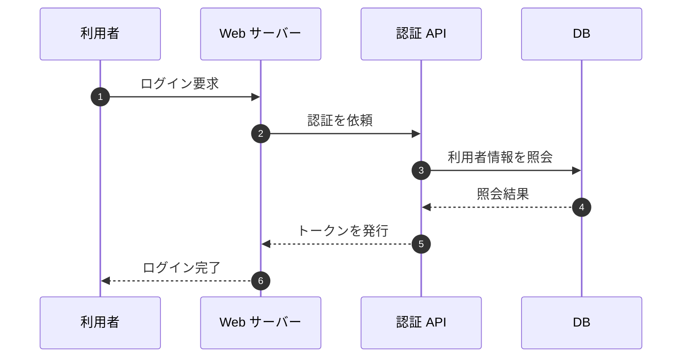

## 概要

調査メモや設計書を、1 つの HTML ファイルで配るためのテンプレートです。本文はこのファイルの先頭にある Markdown のブロックに書き、ブラウザで開くと次のように表示されます。

- 左側に、H2・H3 から作った目次（いま読んでいる位置に印が付く）
- テーマは「システム設定に合わせる」「ライト」「ダーク」の 3 つから切り替え
- <kbd>S</kbd> キーで、H2 ごとに 1 枚のスライドとして表示（この文書は H3 ごと）
- <kbd>D</kbd> キーで、元の Markdown をダウンロード

> [!NOTE]
> 外部のライブラリやサーバーがなくても、このファイルだけで動きます。外部と通信するのは、本文に Mermaid の図があるときに描画ライブラリを CDN から読み込む場合だけです。通信させたくない文書では、ファイル末尾にある `CONFIG.mermaidSrc` を空文字にしてください（図はソースのまま表示されます）。

## 使い方

### 新しく書く

1. このファイルを複製して、名前を変える
2. テキストエディタで開き、`<script type="text/markdown" id="md-source">` の中を書き換える
3. ブラウザで開く

本文に `</script>` と書くときだけは、`/` の前に `\` を入れてください。HTML の仕様上、そこで Markdown のブロックが終わってしまうためです。

### 手元の Markdown から作る

1. このファイルをブラウザで開く
2. `.md` ファイルを画面にドラッグ＆ドロップする
3. <kbd>Ctrl</kbd>+<kbd>S</kbd> で HTML として保存する

保存した HTML には、Markdown と描画済みの本文の両方が入ります。JavaScript が動かない環境（メールソフトのプレビューなど）でも本文は読めて、Mermaid の図もオフラインで表示されます。

### その場で直す

<kbd>E</kbd> キーで左に Markdown の編集欄が開き、入力した内容が右側にすぐ反映されます。直し終えたら <kbd>Ctrl</kbd>+<kbd>S</kbd> で保存します。保存しないままページを閉じようとすると、ブラウザが確認を出します。

> [!WARNING]
> 保存した HTML の本文部分をエディタで直しても、次に保存したときに Markdown から作り直されて消えます。直すのは常に Markdown 側です。

## ショートカットキー

| キー | 動作 |
|---|---|
| <kbd>J</kbd> / <kbd>K</kbd> | 次 / 前の見出しへ移動 |
| <kbd>B</kbd> | 目次の表示を切り替え |
| <kbd>T</kbd> | テーマを切り替え（OS に合わせる → ライト → ダーク） |
| <kbd>S</kbd> | いま読んでいる位置からスライドを開始（<kbd>Shift</kbd>+<kbd>S</kbd> で最初から） |
| <kbd>F</kbd> | 全画面表示 |
| <kbd>E</kbd> | Markdown を編集 |
| <kbd>D</kbd> | Markdown をダウンロード |
| <kbd>Ctrl</kbd>+<kbd>S</kbd> | HTML として保存 |
| <kbd>?</kbd> | ショートカットの一覧 |

スライドの表示中は、<kbd>→</kbd> や <kbd>Space</kbd> で次へ、<kbd>←</kbd> で前へ進みます。数字を入力して <kbd>Enter</kbd> を押すとそのページへ移動し、<kbd>Esc</kbd> で終了します。

## スライドとして使う

- 1 枚目は表紙（フロントマターの内容）で、その後は H2 ごとに 1 枚になる。H3 でも分けたいときは、フロントマターに `slide_level: 3` と書く
- 1 枚に収まらないときは、文字を 50% まで縮める。それでも収まらなければ、そのスライドだけスクロールできるようにする
- 自分で区切りたいところには、`<!-- slide -->` を 1 行で書く（読み物の表示では見えない）
- スライドの表示中に <kbd>Ctrl</kbd>+<kbd>P</kbd> を押すと、16:9 で 1 枚 1 ページの PDF を作れる。スクロールが必要なスライドは、はみ出した部分が PDF に出ない

縮める下限は、ファイル末尾の `CONFIG.slideMinScale`（初期値 50）で変えられます。

> [!WARNING]
> スクロールが必要なスライドで <kbd>→</kbd> を押すと、下の部分を見せないまま次へ進みます。収まらないスライドは、自分で区切ってください。

> [!TIP]
> スライドの表示中は URL の末尾が `#slide-3` のようになります。再読み込みしても同じページから再開でき、この URL を開くとそのページからスライドが始まります。

## 印刷と PDF

読み物の表示で <kbd>Ctrl</kbd>+<kbd>P</kbd> を押すと、次の形で印刷されます。

- 表紙 → 目次 → 本文の順に並ぶ
- 色は常にライトテーマになり、ツールバーと目次の欄は出ない
- 各ページの上に文書名と機密区分、下にページ番号が入る（Chrome・Edge）
- リンクは、表示している文字と URL が違うものだけ、URL を後ろに書き添える
- 折りたたみ（`<details>`）は開いた状態で印刷する

章ごとに改ページしたいときは、フロントマターに `h2_pagebreak: true` と書きます。任意の位置で改ページしたいときは `<!-- pagebreak -->` を 1 行で書きます（スライドもそこで次のページに送られます）。

## フロントマター

本文の先頭に `---` で囲んで書きます。どの項目も省略できます。

| キー | 内容 | 例 |
|---|---|---|
| `title` | 文書名。無ければ先頭の `# 見出し` を使う | 〇〇システム 基本設計書 |
| `subtitle` | 副題 | |
| `docid` / `version` | 文書番号・版 | 1.0 |
| `date` / `updated` | 作成日・更新日 | 2026-11-10 |
| `author` / `reviewer` / `approver` | 作成・レビュー・承認 | |
| `status` | `draft` / `review` / `approved` / `final` / `obsolete` | review |
| `classification` | 機密区分。表紙と印刷時のヘッダーに出る | 社外秘 |
| `numbering` | `true` で H2・H3 に章番号を振る | true |
| `slide_level` | `3` で H3 でもスライドを分ける | 2 |
| `h2_pagebreak` | `true` で印刷時に H2 の前で改ページ | false |
| `filename` | 保存するときのファイル名（拡張子なし） | design-v1 |

表に無いキー（`customer: 〇〇株式会社` など）も、表紙の欄にそのまま並びます。章番号を付けたくない見出しは、`## 改版履歴 {-}` のように末尾に `{-}` を付けます。見出しに `{#ID}` を付けると、その ID で参照できます。

## 書式の見本

### 文字の装飾

**太字**、*斜体*、~~取り消し線~~、==蛍光ペン==、`インラインコード`、<kbd>Ctrl</kbd>+<kbd>C</kbd>、[リンク](https://example.com)。URL はそのまま書いてもリンクになります。https://example.com/docs

日本語の文中でも、**「強調」**のように記号の直後で閉じた強調がそのまま効きます。

### 表

| 項目 | 現行 | 移行後 | 備考 |
|:---|:---:|---:|---|
| OS | RHEL 7 | RHEL 9 | サポート終了への対応 |
| DB | Oracle 12c | PostgreSQL 16 | 移行ツールで変換 |
| 月額費用（円） | 1,200,000 | 850,000 | 税抜 |

### コード

```bash:deploy.sh
#!/usr/bin/env bash
set -euo pipefail
systemctl restart app.service
```

```yaml title="config.yml"
server:
  port: 8080
  timeout: 30s
```

### 図（Mermaid）



### 注記

> [!NOTE]
> 補足。読み飛ばしても困らない情報に使います。

> [!TIP]
> ヒント。知っていると作業が楽になる情報に使います。

> [!IMPORTANT]
> 重要。必ず読んでほしい情報に使います。

> [!WARNING]
> 注意。作業の前に確認が必要な点に使います。

> [!CAUTION]
> 警告。誤るとデータを失う操作などに使います。

### チェックリスト

- [x] 要件定義書のレビュー
- [x] 方式設計
- [ ] 性能試験
  - [ ] 負荷シナリオの作成
  - [ ] 実施と報告

### 折りたたみ

<details>
<summary>ログの全文</summary>

```text
2026-11-10 09:00:01 INFO  service started
2026-11-10 09:00:05 WARN  slow query (1.2s)
```

</details>

### 脚注

調査結果には、出典を脚注で付けられます[^src]。同じ脚注を何度参照しても、番号は 1 つです[^note][^src]。

[^src]: 出典の例：〇〇省「△△ガイドライン」2026 年版
[^note]: 脚注は文書の末尾にまとめて表示されます。

## 雛形

用途に合わせて、次の骨組みを Markdown のブロックに貼り付けて書き始めてください。

### 調査報告

~~~~markdown
---
title: 〇〇の調査報告
author:
date: 2026-11-10
status: draft
---

## 要旨

（結論を 2〜3 行で）

## 背景と目的
## 調査方法
## 結果
## 考察と推奨事項
## 参考資料
~~~~

### 設計書

~~~~markdown
---
title: 〇〇システム 基本設計書
docid:
version: 0.1
date: 2026-11-10
author:
status: draft
classification: 社外秘
numbering: true
h2_pagebreak: true
---

## 改版履歴 {-}

| 版 | 日付 | 作成者 | 内容 |
|---|---|---|---|
| 0.1 | | | 初版 |

## はじめに
### 目的
### 対象範囲
### 用語
## システム概要
## 方式設計
## 機能設計
## 非機能設計
## 運用設計
~~~~

## 改版履歴 {-}

| 版 | 日付 | 作成者 | 内容 |
|---|---|---|---|
| 1.0 | 2026-11-06 | 作成者名 | 初版 |
